<div align="center">


**English** · [Русский](README.ru.md)

-ff5cad?style=flat-square&labelColor=241432)


</div>


```text
CASE ............. #0031-12
ADDRESS .......... flat 14, fourth floor
CALL ............. 01.01.2003, 00:14. neighbours: smell of burning
OCCUPANT ......... aged 22. lived alone. expelled from university
SEIZED ........... desktop tower: case melted, drive intact
                   disc "SAVE YOURSELF", logo: a wheel with eyes
                   glasses, wired, cheap
                   ashtray
                   VHS-C tapes, 12 pcs., labelled by hand
CONDITION ........ drive reads. last save: 31.12.2002 23:59:59
```


> **DETECTIVE.** The tapes were under the desk in a tin biscuit box. The labels are about the drive; the footage is about her. On the drive is a desktop for **CachyOS / Arch** on [**niri**](https://github.com/YaLTeR/niri) with a shell on [**Quickshell**](https://quickshell.org). Build date: 2026. This is impossible. We have put all of it here. Someone is sitting in the corner of the panel. Identity not established.


<sub>▶ <b>STILL 00</b> · the drive, first power-on after seizure · nobody had touched the settings</sub>

> [!NOTE]
> Every still and clip on this page was re-shot by us on a clean install, in a nested niri session with an empty
> home: user `angel`, nobody's notifications, nobody's chats. In a nested session niri uses `Alt` as `Mod`; on real
> hardware `Mod` is **Super / Windows** (⌘ in the macOS look), and that is what the key tables say.

<div align="center">

**INVENTORY**

| | | | | |
| :-: | --- | --- | :-: | --- |
| [01](#tape-01) | *the note* · install | | [07](#tape-07) | *goldengate.app* · the macOS look |
| [02](#tape-02) | *two faces* · Pixel or macOS | | [08](#tape-08) | *someone in the corner* · the game |
| [03](#tape-03) | *the wallpaper breathes* | | [09](#tape-09) | *other people's things* · plugins |
| [04](#tape-04) | *i right-clicked* · menus, widgets | | [10](#tape-10) | *it looks after itself* · updates |
| [05](#tape-05) | *everything can be changed* · settings | | [11](#tape-11) | *what it runs on* · hardware |
| [06](#tape-06) | *windows on a strip* · niri, terminal | | [12](#tape-12) | *save yourself* · the repository |
| | | | [▤](#tape-keys) | *taped under the keyboard* · keys |

</div>


<a id="tape-01"></a>

> **▶ RECORDING** · 20.12.2002 23:41\
> it's his camera, he forgot it. let it record, since its owner's gone.\
> got dumped. by text. in translit, so it'd fit in one. **thrifty**.\
> ***holds a scrap of paper up to the lens*** ten-day plan, three lines: don't call. don't call. buy cigarettes.\
> already failed the first two.

**◉ NOW**\
oh, a new one. hi. i'm the tour guide here. make up a name for me yourself, don't ask about the old one.\
here's the scrap of paper, three lines, type them into the terminal. then it asks the rest by itself: dark or light, which wallpaper, where you're coming from. answer honestly, it won't rush you.\
then there'll be a minute you won't remember. i've got one like that too. then the wizard and the tips.\
don't listen to the recording up there. it's not mine. well, it is. let's skip it.

<div align="center">
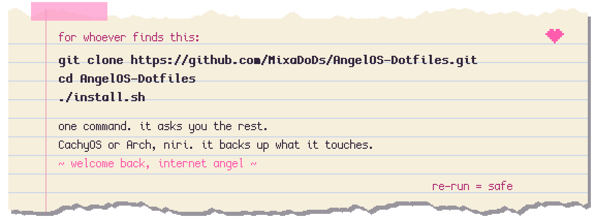

<sub>▶ <b>EVIDENCE 01-A</b> · the scrap of paper, as it lay under the keyboard</sub>
</div>

```bash
git clone https://github.com/MixaDoDs/AngelOS-Dotfiles.git
cd AngelOS-Dotfiles
./install.sh
```


<details>
<summary>✉ <b>inventory, tape 1</b> · install</summary>

<br>

Before: Arch Linux or CachyOS, the internet, your own user (not root) with sudo (`sudo pacman -S --needed git`
first on a bare Arch). About 10–30 minutes, mostly downloads.

The installer is a small show right in the terminal: a hard disk spins up, the angel flaps its wings
([chafa](https://hpjansson.org/chafa/) draws real pictures in kitty, foot, Konsole, WezTerm; coloured blocks in any
other terminal and in the bare Linux console), menus by [gum](https://github.com/charmbracelet/gum), a progress bar
of hearts, a chat commenting on it, quiet music while it works (`NO_MUSIC=1` mutes it, `NO_ANIM=1` stills it). It
works the same from a console after a fresh install (Ctrl+Alt+F2), over `ssh -t`, or in a terminal inside KDE or GNOME.

It asks only what the system needs; the look, the game, the apps, the keyboard and voice input come with the setup
wizard on the first login:

| Question | Options |
| --- | --- |
| Wallpapers | packs from [PixelStreetArt_Wallpapers](https://github.com/MixaDoDs/PixelStreetArt_Wallpapers), only the ticked folders |
| Terminal | fish with its look as the login shell (`FISH_DEFAULT=0` keeps yours) |
| Login screen | the angelOS SDDM theme (with GDM or Plasma's own, keeping it is the default) |
| Main screen | with two screens or more, inside a running niri |
| Programs | a system monitor, an archiver, file compare and small console tools |

Then one screen says everything that will happen — packages and their size, the login screen, the shell, groups —
with **Start**, **Change the answers** or **Quit**. Nothing is touched before it, and the admin password is asked
once. Everything it replaces is backed up first (`name.bak.YYYYMMDD-HHMMSS`), then `niri validate` runs; the log is
in `~/.local/state/angelos/`. Safe to run again. Without questions: `INTERACTIVE=0` with the answers as environment
variables (`DOTFILES_MODE`, `ANGELOS_THEME`, `MAC_KEYS`, `KB_LAYOUTS`, `INSTALL_APPS` and the rest: `./install.sh --help`).
How it is built: [installer/README.md](installer/README.md).

After the first login, a setup wizard: language, where you are coming from (Windows, a Mac, another Linux, nothing), the
game or just a desktop, the main screen, layouts, mouse, light or dark, a wallpaper, how much should move; then the tips.
Settings → Account replays both. If the wizard hangs: `angelos setup skip` from a text console.

</details>


<a id="tape-02"></a>

> **▶ RECORDING** · 21.12.2002 14:05\
> woke up in my jeans. on ICQ he's "away". from me, apparently.\
> to mum i'm "studying", on the forum i'm witty, with him i was… ***waves a hand*** anyway, the switch sticks.\
> Zemfira on repeat. "Iskala", twentieth time or so.

**◉ NOW**\
the desktop has two faces: **Pixel** and **macOS**. one click in the settings and everything's different: windows, sounds, cursor, keys. switch back and it's like nothing happened.\
in the pixel one the words of whatever's playing run along the panel. put something on.\
just not Zemfira. why? because.

 


<details>
<summary>✉ <b>inventory, tape 2</b> · two looks</summary>

<br>

Settings → Appearance switches the look at any time; everything the look changed outside the shell (GTK, Qt, the
cursor, niri's keys) comes back when you leave it.

| | **Pixel** (angelOS) | **macOS** (Golden Gate) |
| --- | --- | --- |
| Panel | a Win98 taskbar: pixel-heart workspaces, window buttons, the **current lyric line** in the middle | a menu bar: the app's own menus, Control Center, Spotlight, the date |
| Apps | Start menu + launcher | a **Dock** with magnification, minimized windows, Downloads and Trash |
| Windows | pixel frames, 4 px corners, a thin accent outline | 16 px corners, shadows, traffic lights, **minimize to the Dock** |
| Glass | — | **Liquid Glass**: niri's blur under the shell, a lens edge drawn by a shader |
| Sounds | the Y2K pack | Mac-like system sounds (its own, CC0) |
| Keys | angelOS's (`Mod`+`Space`, `Mod`+`Q`…) | optional **⌘ keys**: ⌘Q ⌘W ⌘M ⌘Space ⌘Tab, tiling on `Super`+`Alt` |
| Font, cursor | pixel fonts, pixel cursors | Inter, the `macOS` cursor |

Lyrics are synced, from [lrclib.net](https://lrclib.net) over MPRIS. Palettes: `bubblegum`, `overdose`, `cyber angel`,
Gruvbox, Rosé Pine, Catppuccin, or colours pulled out of the wallpaper.

</details>


<a id="tape-03"></a>

> **▶ RECORDING** · 22.12.2002 02:17\
> two a.m. the internet's cheaper at night. the modem's screaming like it's being murdered.\
> someone in the yard is trying out firecrackers. too early, idiots, ten more days.\
> turned the light off. at least something's moving on the screen.

**◉ NOW**\
the wallpaper here is alive. stars blink, the water ripples, light runs round the ring in the sky. maximise a window and it all freezes. only breathes when someone's looking. **sounds familiar**.\
every release has its own wallpapers, one set for day, another for night. the night ones are better, the stars fa…\
***a bang outside***\
has it started?\
…right. releases. there are three. scroll.


<div align="center">


<sub>▶ <b>EVIDENCE 03-A</b> · contents of <code>~/Pictures/AngelOS/</code>: 01 Angel · 02 Archangel · 03 Uriel (Beta), day over night</sub>
</div>


<sub><b>DETECTIVE.</b> There is an ashtray in shot on tape 03. The butts are stubbed out down to the filter, every one. Tidy.</sub>

<details>
<summary>✉ <b>inventory, tape 3</b> · live wallpaper</summary>

<br>

The shell looks at the picture and finds the sky, the water, the clouds, the thing in the sky, and moves only those;
under a full-screen window it goes still and costs almost nothing. *Settings → Wallpaper → Alive* switches the layers one
by one. A picture can carry a hint next to it (`picture.scene.json`: which part is sky, which is water, where the ring
is); without one it gets the automatic look.

Every release comes with its own wallpapers, drawn for it, in a day and a night version. The shell picks day or night
by the theme and the shape by the monitor: 16:9, 21:9, or 9:16 when the screen is turned on its side. The installer puts
them in `~/Pictures/AngelOS/`. `Mod`+`Shift`+`Return` opens the picker: one picture for every screen, one per monitor or
one per workspace. Changing it plays a pixel mosaic with a dither, only when the picture changes.

</details>


<a id="tape-04"></a>


> **▶ RECORDING** · 22.12.2002 19:30\
> the forum lot want me at a meetup, they're giving away some disc. **not going**.\
> right-clicked his photo. "delete". *are you sure you want to…* no, fuck, i'm not sure. ***clicks "yes"***\
> opened the recycle bin. ***pause*** restored it. **idiot**. ***pulls on a boot***

**◉ NOW**\
right-click the desktop. the menu comes in six kinds, pick any. there's a sev̷enth in the files. it's mine, don't touch it yet.\
you can throw widgets on the desktop: a clock, a player, a system monitor.\
just don't hang photos. ***quickly*** just a tip.


<sub><b>DETECTIVE.</b> The seventh menu exists. We are not printing it.</sub>

<details>
<summary>✉ <b>inventory, tape 4</b> · menus and widgets</summary>

<br>

Whatever the menu looks like, it holds the same things: quick actions on top, **View ▸** (widgets, edit mode, snap to
grid), **New ▸** (note, screenshot, recording), **Open ▸** (folders), display settings, personalisation, *Open in
Terminal*, and **Show more options ▸** for what the plugins add. What is in it, in what order, your own items:
*Settings → Right-click menu*.

Widgets (`clock.exe`, `sysmon.exe` with CPU/GPU/RAM/VRAM/net, `cava.exe`, `music.exe` and the plugins' own) live on the
wallpaper and are dragged by the title bar; double-click the title for edit mode. Around each one: a pixel window, a
plate, or nothing.

</details>


<a id="tape-05"></a>


> **▶ RECORDING** · 23.12.2002 11:52\
> head like a bucket. brought back from the meetup: a disc, glasses on a wire and somebody else's lighter.\
> the cover says "save yourself", the disc has a wheel with eyes. ***spins the disc*** an ad for a cult.\
> i'll install it later. mineral water first.

**◉ NOW**\
settings. everything changes: the panel, fonts, sounds, the login and lock screens, thirteen animations for switching workspaces. i went through all thirteen. the whole fucking evening, gone.\
if you don't touch a window for a long time, a cobweb grows on it. i've got one hanging since two thousand and tw… since the day before yesterday. doesn't matter.


<details>
<summary>✉ <b>inventory, tape 5</b> · what can be changed</summary>

<br>

- **The bar:** six shapes (a taskbar, a top bar, an island, a dock, capsules, *windose*), any edge of the screen, the
  layout by dragging.
- **Settings itself:** four faces (Windows 11, a macOS sidebar, a Win98 Control Panel, Properties tabs;
  `angelos settingsView …`), search with synonyms and history.
- **Alt+Tab:** three styles (angelOS, NGO, Y2K) or niri's own with live previews.
- **Switching workspaces:** thirteen animations — soft, dash, spring, snap, zoom, card, wipe, fade, dissolve, glitch,
  CRT, realm, instant; a `workspace_N.exe` popup and a row of hearts.
- **The login screen** (SDDM): five looks, a live preview, the same wallpaper as the desktop. **The lock screen:** two —
  a stream with a chat, or a gate in the sky.
- **fastfetch:** seven styles (compact, angel, helper, receipt, stream, window, mini), each with its own sigil.
- **Fonts** by preset, pixel or not. **Cursors** pixel or `macOS`. **Sounds** in packs (Y2K, Overdose, macOS), on
  every event or never, quieter under music.
- **Windows:** width presets, a width per app, where new ones open; a cobweb on a window nobody has touched for hours.
- **Display:** drag the screens around; the exact refresh rates niri lists, rotation, scale — they survive a reboot.
- Every change to niri's config is backed up, checked with `niri validate` and put back if niri says no. The browsers
  follow the theme (Helium and Chromium through GTK, Firefox through `userChrome.css`).

</details>


<sub>▶ <b>STILL 05-A</b> · the login screen, as she left it</sub>


<a id="tape-06"></a>


> **▶ RECORDING** · 24.12.2002 21:08\
> the catholics have christmas eve, i have instant noodles.\
> three monitors, all fat, all humming. ICQ on one, the forum on the second, his photo on the third.\
> didn't open it. **didn't open it**, i said.

**◉ NOW**\
this is niri. windows don't climb on top of each other, they line up on an endless strip and you scroll it sideways. lost? `Mod`+`Tab`, the overview, everything from above. `Mod`+`Space` opens the launcher, it remembers what you run. there's a terminal too, don't piss yourself.\
you've got one monitor? that's fucked. i had three. fat ones.


<details>
<summary>✉ <b>inventory, tape 6</b> · niri, launcher, terminal, tools</summary>

<br>

niri: windows are columns on an endless horizontal strip; new ones open to the right, the view follows the focus;
columns change width, centre, stack, turn into tabs or floating windows. `Mod`+`Tab` is the overview of every
workspace.

`Mod`+`Space` is the launcher: fuzzy search that learns what you open; `web …` for the web and your own sites,
`plugins …` for the catalog, `claude …` for Claude Code, `> command` for anything in `sh`. Forgot a key:
`Mod`+`Shift`+`Esc` shows niri's overlay, every bind with a readable name.


**fish** with the pure prompt, fastfetch with the angelOS logo as the greeting, eza, fzf, done, autopair (on CachyOS this
is `cachyos-fish-config`; on Arch the same comes from `packages/fish.txt` and fisher). **kitty**, **foot** and
**Alacritty** wear the palette, so do **btop** and **fastfetch**. **Neovim** with [LazyVim](https://lazyvim.github.io)
goes in only where `~/.config/nvim` is empty; an existing config is never touched. `n` opens it; `angelos …` is on the `PATH`.

| tool in `~/.local/bin` | what it does |
| --- | --- |
| `niri-screenshot-region` | a region, with pixel "gravity ropes" |
| `niri-record-region` | toggle a recording to `~/Videos` |
| `niri-ocr` | a region's text to the clipboard, every installed Tesseract language |
| `niri-cast-privacy` | chats and password managers go black on a stream |
| `niri-game-mode` | no animations, blur or glass while a game covers a screen |
| `polkit-agent-guard` | a password dialog always comes |
| `voxtype-indicator` | dictation |

</details>

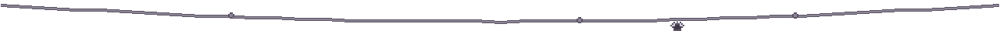

<a id="tape-07"></a>

> **▶ RECORDING** · 25.12.2002 16:44\
> new mac in the magazine. buttons like boiled sweets, windows drain down like into a funnel. costs three of my computers and a kidney.\
> cut it out, stuck it on the monitor. **what have i come to**.

**◉ NOW**\
the macOS look. the dock's at the bottom, icons swell under the mouse. minimise a window and it rides into the dock as a little picture. the glass on the panels is real. well, a shader, but pretty.\
***sniffs*** you don't have anything… no? okay. never mind. the dock, i was saying.


<sub><b>DETECTIVE.</b> "goldengate.app" is written on the tape in her handwriting. No program by that name existed in 2002. We checked twice.</sub>

<details>
<summary>✉ <b>inventory, tape 7</b> · the macOS look (Golden Gate)</summary>

<br>

The whole desktop as macOS 27 *Golden Gate*, drawn from screenshots and Apple's guidelines, not from memory, and without a
single file of Apple's. Pick it in the installer, in the wizard (*"Coming from a Mac?"*), in Settings → Appearance, or with `angelos settingsSkin goldengate`.

- **The menu bar.** 24 pt on top of every screen. On the left the angelOS emblem (About, Settings, Force Quit, Sleep,
  Restart, Shut Down, Lock, Log Out), the app's name in bold and **its own menus**: Qt over dbusmenu, GTK 3 through
  `appmenu-gtk-module`, GtkApplication actions, and for the rest a standard set built from the app's own shortcuts.
  Nothing in the menus is dead. On the right: sound, layout, Wi-Fi and Bluetooth, the tray, Spotlight, **Control
  Center**, the date. `Ctrl`+`F2` walks the menus.
- **The Dock.** A Liquid Glass slab: pinned apps, *Applications*, recent ones, **minimized windows**, Downloads, Trash.
  A dot under running apps, a right-click menu with windows and `.desktop` actions, **magnification** like on a Mac,
  auto-hide. Icons from [MacTahoe](https://github.com/vinceliuice/MacTahoe-icon-theme) (GPL-3.0, pinned release,
  sha256-checked).
- **Minimize.** niri can't minimize; angelOS can: the window goes to a hidden workspace and **its snapshot lands on the
  right of the Dock**. The yellow light, *Window → Minimize*, `⌘M`, or `angelos macMinimize`; back with a click on the
  snapshot, the icon, Alt+Tab or the overview.
- **Spotlight** (`⌘Space`): apps, files, actions, the clipboard. **Control Center** in the macOS layout. The date
  opens the **Notification Center**.
- **Liquid Glass**: niri 26.04's blur and saturation under the glass, a tint from clear to tinted, and a lens edge
  drawn by [`shaders/liquid_glass.frag`](.config/quickshell/angelos/shaders/liquid_glass.frag). *Reduce
  transparency* makes it solid.
- **Sounds** synthesised by `scripts/mac-sounds.py`, CC0; files with the same names in
  `~/.local/share/angelos/sounds/macos/` replace them.


**Not Apple's:** an angelOS emblem instead of the apple, **Inter** (SIL OFL) instead of SF Pro, Lucide icons, MacTahoe
(GPL-3.0), the `macOS` cursor from [ful1e5/apple_cursor](https://github.com/ful1e5/apple_cursor) (GPL-3.0),
synthesised sounds, drawn wallpapers. MacTahoe, Inter and the cursor are downloaded the first time the look is turned
on, under their own licenses.

</details>


<a id="tape-08"></a>

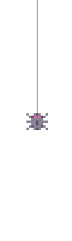

> **▶ RECORDING** · 26.12.2002 03:33\
> can't sleep. someone's sitting in the corner of the room. turned the light on: a jacket on a chair. turned it off: sitting there again.\
> ***cackles*** look at the state of me. on ICQ all the flowers are red.

**◉ NOW**\
and that's me. there, in the corner of the panel, legs dangling. i talk rarely and to the point: six windows in a row, four hours without getting up — i'll notice. **a game**, sure. chests, achievements and my diary, you'll earn the key.\
what's under this floor? there's someone down there. ***pause*** can we just forget it for today?\
listen. how do you see me? fine, tell me later.


<sub>▶ <b>STILL 01-X</b> · that minute you won't remember. taken off the drive</sub>

> [!IMPORTANT]
> **DETECTIVE.** Before we let anyone run the drive, we read the code. This is what we can say for sure:
> **it may scare you, but it never harms.** It does not touch your files, sends nothing anywhere, and never reads
> your windows, browser or chats. The lock screen, the power menu, volume, notifications and polkit always work,
> whatever is going on. Everything that flashes, shakes or gets loud has a *calm* switch.
>
> - **Out at once, any time:** `angelos game off`, or **`Mod`+`Ctrl`+`Shift`+`Esc`**. What stays is plain dotfiles:
>   she is gone, and the right-click menu loses its seventh look. `angelos game on` brings it back. The installer and
>   the wizard ask first.
> - **Motion:** `angelos motion full|calm|off`. *Calm*: no flashes, no shaking, no sudden loud sounds. *Off*: no
>   animations at all.
> - **Progress** lives in `~/.config/angelos/save.json`. Updates never touch it.

<details>
<summary>✉ <b>inventory, tape 8</b> · the game</summary>

<br>

The angel on the bar talks rarely and to the point; there are achievements, chests, and her diary with a key you have
to earn. Y2K sounds: a disc spins up at boot, a chime, her lines in an Undertale-style voice. The lock screen can be an
NGO stream with a chat that answers. In stream mode she sits in the frame and reads the chat. About the lower floor we
will only say that the Dock and the menu bar know about it too.

</details>


<a id="tape-09"></a>

> **▶ RECORDING** · 27.12.2002 20:20\
> three people wrote today. mum: "how's uni". a guy from the forum sent a sheep that walks around on the windows. **him**: nothing.\
> the sheep's walking. at least someone's got a job.

**◉ NOW**\
plugins. other people write them, you install them from the catalog. the cat on the panel sleeps when the computer's chilled and tears around when it's struggling. mini-osu to music. a night light so your eyes don't melt.\
get the cat. it's funny and doesn't ask shit about uni.


<details>
<summary>✉ <b>inventory, tape 9</b> · plugins</summary>

<br>

A plugin is a folder with a `manifest.json`: right-click items, bar and desktop widgets, launcher providers, a settings
page, a background service. The guide is [`docs/PLUGINS.md`](.config/quickshell/angelos/docs/PLUGINS.md).

**Community Plugins:** a catalog in *Settings → Plugins* (and `plugins …` in the launcher): the approved entries of the
[angelOS community registry](https://github.com/futureUnd1ground/angelos-community-registry) next to what is installed:
install, update, **roll back**. Updates are checked once a day; before each one the installed copy becomes a snapshot,
and a plugin that does not load goes back to it by itself. With *Developer mode* on, **Plugin Studio** asks what the
plugin should do, writes themed QML with your own OpenAI or Anthropic key, shows the files and checks them before you
install ([guide](.config/quickshell/angelos/docs/PLUGIN_STUDIO.md)).

| Built in | What it does |
| --- | --- |
| `cat` | a pixel cat on the bar: asleep, walking or running with the CPU load |
| `speedtest` | an internet speed test with a pixel speedometer and a history |
| `web-search` | `web …` in the launcher: search engines and favourite sites |
| `claude-companion` | what is left of your Claude plan, live Claude Code sessions, `claude …` in the launcher |
| `codex-companion` | the same for OpenAI Codex: 5-hour and weekly windows, today's tokens, live sessions |
| `osu-mini` | a mini osu to the beat: pixel hearts, combos, ranks (`osu` in the launcher) |
| `nightlight` | a warm screen in the evening through `wlsunset` |
| `stream-stats` | `stats.exe`: stress = CPU, darkness = RAM, love = uptime |
| `quick-actions` | extra right-click items |

</details>


<a id="tape-10"></a>


> **▶ RECORDING** · 28.12.2002 09:15\
> morning. ***shows a strand of hair*** the box said "ripe cherry". came out boiled beetroot.\
> **looking after myself**. what the hell difference does it make.

**◉ NOW**\
updates. settings check by themselves whether there's something new and pull it in on a click. before that they copy everything, so there's a button at the bottom: "restore the state before the update". **restore**. press it, and it's how it was.\
something broke — "report a problem" packs an archive with nothing personal in it and sends it nowhere by itself.\
listen, what year is it now? ***looks at the clock on the panel*** yes, i can see it. i was just asking.


<details>
<summary>✉ <b>inventory, tape 10</b> · updates and reports</summary>

<br>

*Settings → Updates* checks the repository everything was installed from and, on a click, runs `git pull` and the
installer without packages. Before that, every file the installer may write is copied to
`~/.local/state/angelos/backups/<date>-update/`. An update counts only when the installer, the niri wiring and
`niri validate` all pass; otherwise the page offers the restore. A running angelOS asks whether to restart now or
later; windows stay open. From a terminal: `git pull && ./install.sh`.

A config you never changed follows the author; one you changed gets the author's changes merged in, and where both
changed the same lines, yours stay (the old file next to it as `*.bak.<date>`); shortcuts merge key by key. Files
angelOS generates stay yours, the new versions parked in `~/.local/state/angelos/kept-updates/`. Your own lines go in
`~/.config/fish/user.fish` and `~/.config/niri/cfg/user.kdl`, read last, never touched. Apps the author added to your
groups are only *offered*; it never installs or removes anything by itself.


*Settings → About → Report a problem* (or `angelos report`) packs one archive: versions (angelOS, Quickshell, Qt,
niri, kernel, GPU), the service state and restarts, the log, the last crash reports, the niri config check, plugins
and settings, with the personal bits taken out (the home path and user name become `~` and `<user>`; launcher history,
workspace names and free texts are left out). **Nothing is sent anywhere.** A watchdog restarts the shell if it stops
answering for fifteen seconds. The login screen keeps a backup of the previous theme. The installer never overwrites
`monitor.kdl`.

</details>


<a id="tape-11"></a>

> **▶ RECORDING** · 30.12.2002 22:47\
> bought champagne and tangerines. for one, yes. the disc's for tomorrow.\
> the monitors heat the room better than the radiator. there's a mountain in the ashtray. i'll empty it next year. ***laughs***

**◉ NOW**\
hardware. i live on laptops and desktops, as many monitors as you like, each set up its own way. russian and english, layouts, a big interface, a magnifier, voice dictation.\
and i remind you about water. ***sternly*** when did you last drink something? go pour some. i'll wait, i'm not going any… go, i said, for fuck's sake.

<sub><b>DETECTIVE.</b> We tested the glasses. The sound in them is loud; you cannot hear the room. There is a microphone.</sub>

<details>
<summary>✉ <b>inventory, tape 11</b> · what it runs on</summary>

<br>

| | |
| --- | --- |
| **System** | CachyOS or Arch Linux. The installer appends only the `[cachyos]` repository where it is missing; Arch's own packages win. |
| **GPU** | NVIDIA and AMD. The system monitor reads both; the Qt fixes for NVIDIA are in. |
| **Laptop** | battery and charge limit, eco mode, brightness and keyboard-light keys, touchpad direction and acceleration; in the wizard and in Settings, and only on a laptop. |
| **Monitors** | any number, any refresh rate (the exact one niri lists, so 144 Hz stays 144 Hz after a reboot), scale, rotation, portrait screens with 9:16 wallpapers, ultrawides with 21:9. Named by *Make Model Serial*, so a renamed connector still matches. |
| **Keyboards** | any layouts and the switch shortcut you choose; they also pick the dictation language and the OCR packs. ⌘ keys for people from a Mac, GTK window buttons for people from Windows. |
| **Languages** | Russian and English: the installer, the wizard, the shell, and her. |
| **Browsers** | Helium, Firefox, Chromium, Brave, Zen, LibreWolf, Vivaldi or Chrome; the wizard asks, `Mod`+`B` opens the default. |
| **Access** | UI size, motion, contrast, a lens (`Mod`+`Alt`+`=`), voice dictation, shake-to-find-the-cursor. Screen time, breaks, water: she does the reminding. |
| **Gamepads** | the shell knows your controller, its buttons and axes. |
| **Streaming** | an OBS-aware stream mode, `niri-cast-privacy` for chats and password managers, a game mode with no effects while a game covers the screen. |

</details>


<a id="tape-12"></a>


> **▶ RECORDING** · 31.12.2002 23:58\
> ***in the glasses, washing a pill down with champagne*** happy almost new year, camera. can't see a thing, can see everything. **fun**, damn. turned the mobile face down, let him text himself.\
> ***behind her, in the ashtray, a cigarette is smouldering***\
> something smells. the computer's heating up, poor thing, i've been running it for three hours. ***crackling*** oh, it's burning in the game too. pretty.\
> hang on, i'll just save and…\
> *[recording cuts off]*

<p align="center"><code>23:59:59 ░░░░░░░░░░░░░░░░ NO SIGNAL</code></p>

**◉ NOW**\
that's it. this is the whole house, and it's open: take it, copy it. MIT, no passwords, no one else's secrets. just mine. well, what's left.\
don't play the last tape. i haven't seen it either.\
***a bang outside***\
***says nothing***\
let me tell you about the keys instead.

```text
.config/quickshell/angelos/  angelOS: the shell, both looks, plugins, templates, docs
.config/niri/                niri: config, key profiles (common / pixel / macos), rules, animations
.config/                     fish, kitty, foot, Alacritty, GTK, btop, fastfetch, Neovim, Voxtype
.local/bin/                  helper tools
.local/share/                the pixora icon theme and pixel fonts
Pictures/AngelOS/            every release's wallpapers, with their scene hints
packages/                    pacman.txt, angelos.txt, sddm.txt, tools.txt, fish.txt, nvim.txt (the apps: data/apps-catalog.json)
installer/tui.sh             the installer's face: gum menus, pixel frames, hearts, the stream chat
install.sh                   the installer: asks everything, backs up, Arch Linux / CachyOS only
scripts/check.sh             the repository check, with end-to-end installer tests
scripts/demo/                the stand the stills and clips on this page were shot in
docs/                        the stills and clips of this page
```

<sub><b>DETECTIVE.</b> One butt in the ashtray, not stubbed out. Case closed. There is no one to return the drive to. We set the system clock to 2003. It keeps going back.</sub>

<details>
<summary>✉ <b>inventory, tape 12</b> · license, checks</summary>

<br>

MIT, all of it: the dotfiles, the shell, the wallpapers. See [`LICENSE`](LICENSE), © 2026 MixaDoDs. Parts made by
others keep their own licenses, listed in [`THIRD-PARTY.md`](THIRD-PARTY.md), and so does how release 5 «2002»'s
wallpapers were made: with an image model, from the author's prompts, cleaned up by hand. The repository holds no credentials, API
keys, tokens, browser profiles, cookies, history, caches, keyrings or app state, and `scripts/check.sh` fails if one
ever gets in. Your angelOS settings (`~/.config/angelos`) stay yours.

`scripts/check.sh` runs the whole check locally (the same one GitHub runs, in an `archlinux` container through
`scripts/ci-local.sh`). Issues and pull requests are welcome; `angelos report` is a good first attachment.

</details>


<a id="tape-keys"></a>

> **DETECTIVE.** Taped to the underside of the keyboard; the paper did not burn. I have quit smoking. Not because of this case.
>
> Each look has its own profile: [`keybinds.kdl`](.config/niri/cfg/keybinds.kdl) only picks one, [`keybinds-common.kdl`](.config/niri/cfg/keybinds-common.kdl) (both looks) plus [`keybinds-pixel.kdl`](.config/niri/cfg/keybinds-pixel.kdl) or [`keybinds-macos.kdl`](.config/niri/cfg/keybinds-macos.kdl). Settings → Keyboard edits the one in front.

<details>
<summary><b>▤ NOTE 1</b> · both looks</summary>

| Keys | Action |
| --- | --- |
| <kbd>Mod</kbd>+<kbd>T</kbd> | Terminal (kitty) |
| <kbd>Mod</kbd>+<kbd>B</kbd> | Default browser |
| <kbd>Mod</kbd>+<kbd>E</kbd> | Files (Nautilus) |
| <kbd>Mod</kbd>+<kbd>V</kbd> | Clipboard history (Enter pastes into the window you were in, Shift+Enter only copies) |
| <kbd>Mod</kbd>+<kbd>S</kbd> / <kbd>Mod</kbd>+<kbd>Alt</kbd>+<kbd>S</kbd> | Settings |
| <kbd>Mod</kbd>+<kbd>Shift</kbd>+<kbd>Return</kbd> | Wallpaper picker |
| <kbd>Mod</kbd>+<kbd>Shift</kbd>+<kbd>Q</kbd> | Power menu |
| <kbd>Mod</kbd>+<kbd>Alt</kbd>+<kbd>T</kbd> / <kbd>Mod</kbd>+<kbd>Alt</kbd>+<kbd>Y</kbd> | Light ⇄ dark / lyrics on-off |
| <kbd>Mod</kbd>+<kbd>Shift</kbd>+<kbd>S</kbd> | Screenshot a region ("gravity ropes") |
| <kbd>Mod</kbd>+<kbd>Shift</kbd>+<kbd>R</kbd> | Record a region (toggle) |
| <kbd>Mod</kbd>+<kbd>Shift</kbd>+<kbd>V</kbd> | Voice dictation (toggle) |
| <kbd>Mod</kbd>+<kbd>Shift</kbd>+<kbd>X</kbd> | Screencast privacy: chats and password managers go black on the stream |
| <kbd>Ctrl</kbd>+<kbd>Shift</kbd>+<kbd>2</kbd> / <kbd>3</kbd> | Screenshot the screen / the window |
| <kbd>Mod</kbd>+<kbd>Shift</kbd>+<kbd>←→↑↓</kbd> | Focus another monitor (+<kbd>Ctrl</kbd>: move the column there) |
| <kbd>Mod</kbd>+<kbd>Shift</kbd>+<kbd>P</kbd> | Monitors off |
| <kbd>Alt</kbd>+<kbd>Tab</kbd> | angelOS's window switcher |
| <kbd>Mod</kbd>+<kbd>Alt</kbd>+<kbd>=</kbd> / <kbd>-</kbd> / <kbd>0</kbd> | Lens: zoom in / out / close |
| <kbd>Mod</kbd>+<kbd>Esc</kbd> | Release a fullscreen app's keyboard grab |
| <kbd>Mod</kbd>+<kbd>Ctrl</kbd>+<kbd>Shift</kbd>+<kbd>Esc</kbd> | **Out of the game at once** |
| <kbd>Ctrl</kbd>+<kbd>Alt</kbd>+<kbd>Delete</kbd> | Quit niri |

Media and volume keys go to `angelos …` (a small OSD shows the level) and keep working on the lock screen.

</details>

<details>
<summary><b>▤ NOTE 2</b> · Pixel</summary>

| Keys | Action |
| --- | --- |
| <kbd>Mod</kbd>+<kbd>Space</kbd> | Launcher |
| <kbd>Mod</kbd>+<kbd>Q</kbd> | Close window |
| <kbd>Mod</kbd>+<kbd>Alt</kbd>+<kbd>L</kbd> | Lock screen |
| <kbd>Mod</kbd>+<kbd>H</kbd> / <kbd>Mod</kbd>+<kbd>L</kbd> (or arrows) | Focus column left / right (+<kbd>Ctrl</kbd>: move it) |
| <kbd>Mod</kbd>+<kbd>J</kbd> / <kbd>Mod</kbd>+<kbd>K</kbd> | Focus window down / up |
| <kbd>Mod</kbd>+<kbd>1</kbd>…<kbd>9</kbd> / <kbd>Mod</kbd>+<kbd>Ctrl</kbd>+<kbd>1</kbd>…<kbd>9</kbd> | Go to workspace / move the column there |
| <kbd>Mod</kbd>+<kbd>O</kbd> | Previous workspace |
| <kbd>Mod</kbd>+<kbd>Tab</kbd> | Overview |
| <kbd>Mod</kbd>+<kbd>R</kbd> / <kbd>Mod</kbd>+<kbd>Alt</kbd>+<kbd>R</kbd> | Next / previous column width |
| <kbd>Mod</kbd>+<kbd>C</kbd> | Centre column |
| <kbd>Mod</kbd>+<kbd>[</kbd> / <kbd>Mod</kbd>+<kbd>]</kbd> | Pull a window into the neighbouring column, or push it out |
| <kbd>Mod</kbd>+<kbd>W</kbd> | Tabbed column |
| <kbd>Mod</kbd>+<kbd>Shift</kbd>+<kbd>Space</kbd> | Floating ⇄ tiled |
| <kbd>Mod</kbd>+<kbd>F</kbd> / <kbd>Mod</kbd>+<kbd>Shift</kbd>+<kbd>F</kbd> / <kbd>Mod</kbd>+<kbd>M</kbd> | Fullscreen / maximise column / maximise to the edges |
| <kbd>Mod</kbd>+<kbd>-</kbd> / <kbd>Mod</kbd>+<kbd>=</kbd> | Column narrower / wider |
| <kbd>Mod</kbd>+<kbd>Shift</kbd>+<kbd>T</kbd> | OCR a region to the clipboard |

</details>

<details>
<summary><b>▤ NOTE 3</b> · macOS (⌘ = Super)</summary>

The ⌘ keys are optional: the installer asks (`MAC_KEYS=1|0`), and *Settings → Appearance → Golden Gate*
turns them on or off. Without them the macOS look keeps the pixel keys.

| Keys | Action |
| --- | --- |
| <kbd>⌘</kbd><kbd>Space</kbd> | Spotlight |
| <kbd>⌘</kbd><kbd>Q</kbd> | Quit the app in front (its own *Quit*, else all its windows) |
| <kbd>⌘</kbd><kbd>W</kbd> | Close window |
| <kbd>⌘</kbd><kbd>M</kbd> | Minimize to the Dock |
| <kbd>⌘</kbd><kbd>H</kbd> | Hide the app |
| <kbd>⌘</kbd><kbd>Tab</kbd> / <kbd>⌘</kbd><kbd>⇧</kbd><kbd>Tab</kbd> | Switch apps |
| <kbd>⌘</kbd><kbd>`</kbd> | Next window of the same app |
| <kbd>⌘</kbd><kbd>,</kbd> | System Settings |
| <kbd>⌘</kbd><kbd>⇧</kbd><kbd>3</kbd> / <kbd>4</kbd> / <kbd>5</kbd> | Screenshot: screen / area / the screenshot menu |
| <kbd>⌃</kbd><kbd>⌘</kbd><kbd>F</kbd> | Fullscreen |
| <kbd>⌃</kbd><kbd>⌘</kbd><kbd>Q</kbd> | Lock screen |
| <kbd>⌥</kbd><kbd>⌘</kbd><kbd>Esc</kbd> | Force Quit |
| <kbd>⌃</kbd><kbd>←</kbd> / <kbd>⌃</kbd><kbd>→</kbd> | Workspace left / right |
| <kbd>⌃</kbd><kbd>↑</kbd>, <kbd>F3</kbd> | Mission Control (overview) |
| <kbd>⌃</kbd><kbd>F2</kbd> | The menu bar from the keyboard |
| <kbd>⌘</kbd><kbd>⌥</kbd><kbd>Space</kbd> | angelOS's launcher |
| <kbd>⌘</kbd><kbd>⌥</kbd> + <kbd>H</kbd> <kbd>J</kbd> <kbd>K</kbd> <kbd>L</kbd> / arrows, <kbd>1</kbd>…<kbd>9</kbd>, <kbd>R</kbd>, <kbd>C</kbd>, <kbd>F</kbd>, <kbd>W</kbd> | Tiling: the pixel keys, one <kbd>Alt</kbd> further |

Inside apps, their own shortcuts stay theirs (<kbd>Ctrl</kbd>+<kbd>C</kbd>, <kbd>Ctrl</kbd>+<kbd>V</kbd>), and the menus label them that way.

</details>

<details>
<summary><b>▤ NOTE 4</b> · the login screen (SDDM), when it misbehaves</summary>

| Symptom | Fix |
| --- | --- |
| Boots to a text console | `sudo systemctl enable --force sddm && sudo systemctl set-default graphical.target` |
| `display-manager.service already exists` | disable the other one (`gdm`, `lightdm`, `ly@tty2`, `greetd`), then enable SDDM |
| Plain SDDM instead of the angelOS theme | `grep -r Current= /etc/sddm.conf /etc/sddm.conf.d/`; install `qt6-declarative` |
| Missing wallpaper | set a wallpaper in angelOS and check `/usr/share/sddm/themes/angelos/walls/` |

Preview the theme without logging out: `sddm-greeter-qt6 --test-mode --theme /usr/share/sddm/themes/angelos`.

</details>



<div align="center">
<sub><code>♡ thank you for watching the stream ♡</code></sub>
</div>
