<div align="center">


[English](README.md) · **Русский**

-ff5cad?style=flat-square&labelColor=241432)


</div>

```text
ДЕЛО ............. № 0031-12
ИЗЪЯТО ........... 01.01.2003, 04:12, из квартиры на четвёртом этаже
ПРЕДМЕТЫ ......... 1 × системный блок, корпус закопчён, диск цел
                   1 × видеокамера, внутри осталась кассета
                   1 × CD-R, на наклейке маркером: «SAVE YOURSELF»
                   1 × клочок тетрадного листа в линейку, на нём три строки
                   12 × кассета VHS-C, номера проставлены от руки
СОСТОЯНИЕ ........ диск до сих пор загружается
```


> **ПОМЕТКА АРХИВИСТА.** Ниже — кассеты в порядке нумерации, расшифрованные нами, с кадрами, снятыми с диска.
> Часы камеры так никто и не выставил, поэтому на всех таймкодах декабрь 2002-го; не обращайте внимания.
> Расшифровки оставлены как есть. Где плёнка повреждена, это указано. Закрашенное чёрным было закрашено до того,
> как попало к нам.
>
> С диска загружается рабочий стол для **CachyOS / Arch** на [**niri**](https://github.com/YaLTeR/niri) с оболочкой,
> написанной на [**Quickshell**](https://quickshell.org). Мы скопировали его сюда целиком, чтобы вы могли запустить
> его сами. Мы запускали. Всё в порядке. В основном.

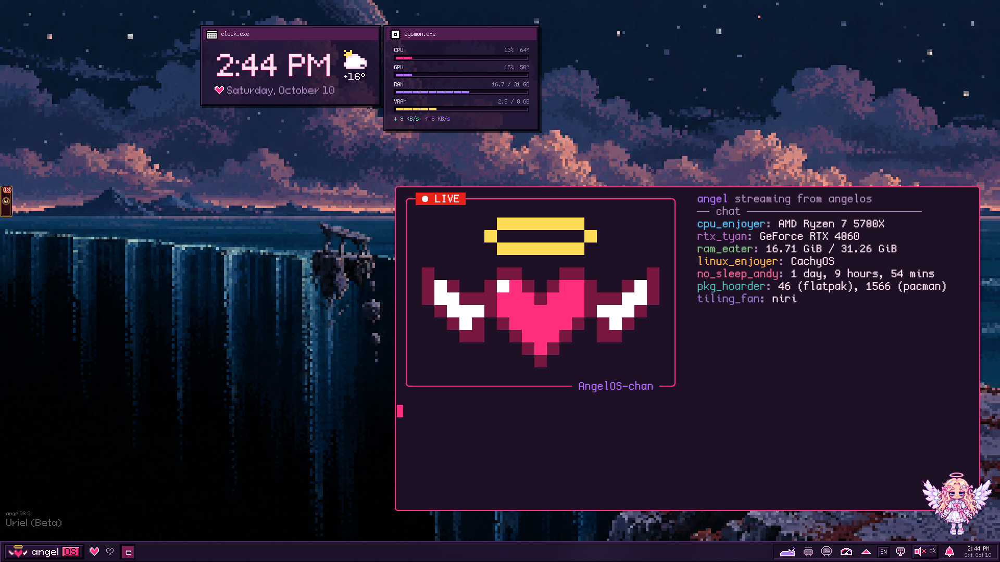

<sub>▶ <b>КАДР 00</b> · диск, первая загрузка после изъятия · настроек никто не касался</sub>

> [!NOTE]
> Все кадры и записи на этой странице мы пересняли сами на чистой установке, во вложенной сессии niri с одноразовым
> домом: пользователь `angel`, ничьих уведомлений, ничьих переписок. Во вложенной сессии niri использует `Alt` как
> `Mod`; на настоящем железе `Mod` — клавиша **Super / Windows** (⌘ в облике macOS), и в таблицах клавиш написано
> именно так.

<div align="center">

**ОПИСЬ КАССЕТ**

| | надпись на наклейке | | | надпись на наклейке |
| :-: | --- | --- | :-: | --- |
| [01](#tape-01) | *записка* · установка | | [07](#tape-07) | *goldengate.app* · облик macOS |
| [02](#tape-02) | *два лица* · Pixel или macOS | | [08](#tape-08) | *кто-то в углу* · игра |
| [03](#tape-03) | *обои дышат* | | [09](#tape-09) | *чужие вещи* · плагины |
| [04](#tape-04) | *я нажал правой* · меню, виджеты | | [10](#tape-10) | *оно следит за собой* · обновления, репорты |
| [05](#tape-05) | *всё настраивается* | | [11](#tape-11) | *на чём оно живёт* · железо |
| [06](#tape-06) | *окна на ленте* · niri, терминал | | [12](#tape-12) | *здесь всё* · репозиторий |
| | | | [▤](#tape-keys) | *приклеено под клавиатурой* · клавиши |

</div>


<a id="tape-01"></a>

`[00:00:00]` *Темнота. Снимается крышка объектива. Настольная лампа, клавиатура, клочок тетрадного листа — его
разглаживают ребром ладони.*

`[00:00:06]` **ГОЛОС (за камерой):** «Три строчки. На форуме написали: три строчки, а остальное оно само спросит».

<div align="center">
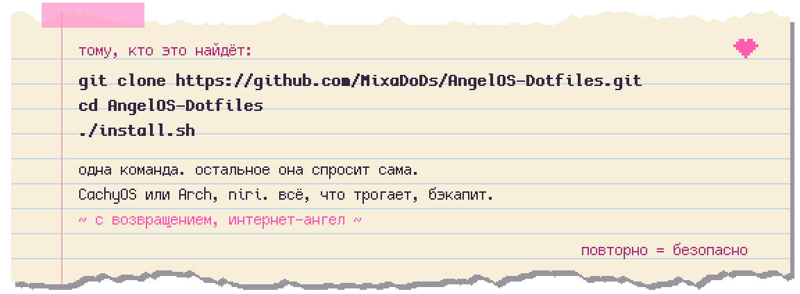

<sub>▶ <b>ВЕЩДОК 01-А</b> · клочок бумаги, как его нашли под клавиатурой</sub>
</div>

`[00:00:14]` *Камера опускается к терминалу. Он набирает.*

```bash
git clone https://github.com/MixaDoDs/AngelOS-Dotfiles.git
cd AngelOS-Dotfiles
./install.sh
```

`[00:00:31]` *Терминал становится пастельным. В нём начинается стрим: пиксельные рамки, меню, где галочки ставят
пробелом, прогресс-бар из сердечек, маленький чат в углу, который комментирует происходящее.*
(Рисует это [gum](https://github.com/charmbracelet/gum).)

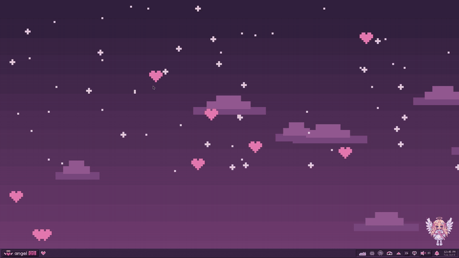

<sub>▶ <b>01 · 00:00:31 – 00:02:50</b> · установщик, снято с монитора</sub>

`[00:01:02]` **ГОЛОС:** «Оно меня спрашивает». *Он зачитывает вопросы один за другим. Мы записали, что он ответил.*

| `[01:02]` спросило | что было на экране |
| --- | --- |
| Профиль | `full` (весь облик) или `tech` (только конфиг niri и утилиты) |
| Оболочка | angelOS (по умолчанию) или ничего |
| Облик | **Pixel** или **macOS**, а для macOS — нужны ли ⌘-клавиши |
| Игра | angelOS как игра или просто дотфайлы (`ANGELOS_GAME=0\|1`) |
| Обои | паки из [PixelStreetArt_Wallpapers](https://github.com/MixaDoDs/PixelStreetArt_Wallpapers), только отмеченные папки |
| fish | поставить с его видом и сделать оболочкой входа (`FISH_DEFAULT=0` оставит текущую) |
| Программы | те, что на кадрах: Helium, Telegram, Spotify, Obsidian, qView, mpv, LocalSend, Discord |
| Остальное | голосовой ввод (Voxtype + модель Whisper), экран входа SDDM, повседневные утилиты |
| Клавиатура | раскладки, какая активна после входа, чем переключать |

`[00:02:50]` *Чат в терминале сообщает, что сначала всё забэкапил* (`имя.bak.ГГГГММДД-ЧЧММСС`), *прогнал*
`niri validate`, *и говорит, что делать дальше.* **ГОЛОС:** «А ещё раз запустить можно?» *Говорит, можно, это безопасно.*

> **АРХИВИСТ.** Есть второй способ, без вопросов: `INTERACTIVE=0` с ответами в переменных окружения (`PROFILE`,
> `ANGELOS_THEME`, `MAC_KEYS`, `KB_LAYOUTS`, `INSTALL_APPS` и остальные, перечислены в начале `install.sh`). Им мы
> пользовались при пересъёмке.

`[00:03:15]` *Он входит в систему. Экран пишет, что доделывает установку.*

`[00:03:19]` ░░░░░░░░ **ПЛЁНКА ПОВРЕЖДЕНА** ░░░░░░░░ *около минуты не читается.* *На кадрах, которые удалось
восстановить: из-под нижнего края экрана что-то поднимается. Потом милая мелодия.* █████████████████

`[00:04:22]` *Мастер настройки, как будто ничего не случилось. Язык. Откуда он пришёл: Windows, Mac, другой Linux,
ниоткуда. Игра или просто стол. Какой экран главный, раскладки, мышь, светлая или тёмная, обои, сколько всего
должно двигаться. Потом пиксельные кружки водят его по экрану и рассказывают, что здесь что.*


<sub>▶ <b>01 · 00:04:22</b> · подсказки. В Настройки → Учётная запись их можно повторить, и мастер тоже</sub>

> **АРХИВИСТ.** Если мастер когда-нибудь застрянет, `angelos setup skip` из текстовой консоли сразу отпускает стол.


<a id="tape-02"></a>

`[00:00:00]` *Дневной свет сквозь жалюзи. Тот же письменный стол.* **ГОЛОС:** «Вчера оно спросило: Pixel или macOS.
Я сказал — пиксельный. Посмотрим второй».

`[00:00:08]` *Настройки → Оформление. Один клик. Весь стол меняет лицо. Ещё клик — и он возвращается, а с ним всё,
что облик менял вне оболочки: GTK, Qt, курсор, клавиши niri.*

| `[00:00:08]` | **Pixel** (angelOS) | **macOS** (Golden Gate) |
| --- | --- | --- |
| Панель | таскбар Win98: столы-сердечки, кнопки окон, **строка лирики** посередине | строка меню: меню самого приложения, Пункт управления, Spotlight, дата |
| Программы | «Пуск» + лаунчер | **Dock** с увеличением, свёрнутые окна, «Загрузки» и «Корзина» |
| Окна | пиксельные рамки, углы 4 px, тонкая акцентная обводка | углы 16 px, тени, светофоры, **сворачивание в Dock** |
| Стекло | — | **Liquid Glass**: блюр niri под оболочкой, край-линза, нарисованный шейдером |
| Звуки | пак Y2K | системные звуки в духе Mac (свои, CC0) |
| Клавиши | клавиши angelOS (`Mod`+`Space`, `Mod`+`Q`…) | по желанию **⌘-клавиши**: ⌘Q ⌘W ⌘M ⌘Space ⌘Tab, тайлинг на `Super`+`Alt` |
| Шрифт, курсор | пиксельные шрифты и курсоры | Inter, курсор `macOS` |

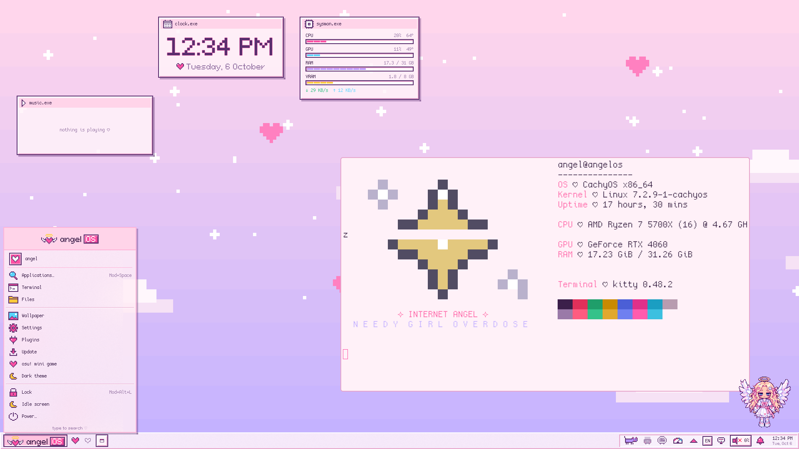 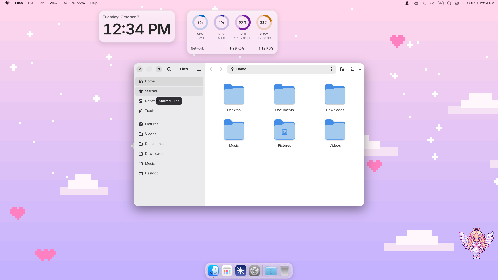

<sub>▶ <b>КАДРЫ 02-А, 02-Б</b> · pixel.exe ✧ goldengate.app, в одном клике друг от друга</sub>

`[00:01:40]` *Где-то за кадром начинает играть музыка. Пиксельная панель печатает строку, которую сейчас поют, как
субтитры на стриме, и старая строка уезжает вверх.* **ГОЛОС:** «Оно знает слова».

> **АРХИВИСТ.** Синхронная лирика с [lrclib.net](https://lrclib.net) через MPRIS. Палитры на плёнке: `bubblegum`,
> `overdose`, `cyber angel`, Gruvbox, Rosé Pine, Catppuccin или цвета, вытянутые из обоев.

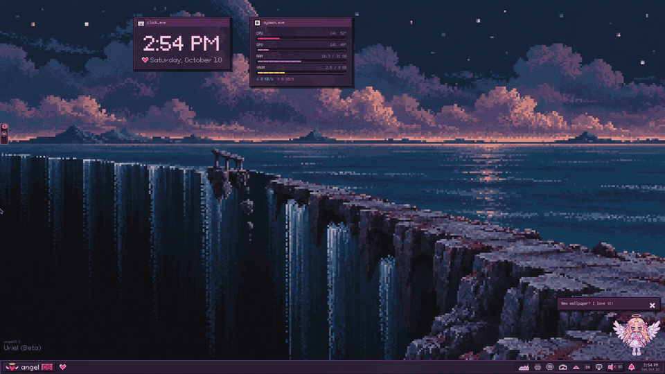

<sub>▶ <b>02 · 00:02:05</b> · вкусы палитры, один за другим</sub>


<a id="tape-03"></a>

`[00:00:00]` *В комнате темно. Только монитор. Камера у самого экрана, видны пиксели.*

`[00:00:11]` **ГОЛОС (шёпотом):** «Смотри на воду».

`[00:00:15]` *Картинка остаётся картинкой, но части её двигаются. Мерцают звёзды, одна падает. Вода идёт рябью и
отражает их. По кольцу в небе пробегает блик. С обрыва срывается камешек, по воде расходятся круги.*

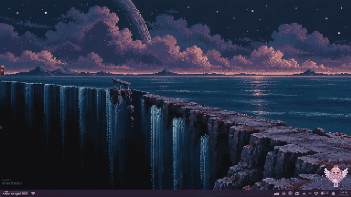

<sub>▶ <b>03 · 00:00:15</b> · ничего не монтировали. оно само</sub>

`[00:01:10]` *Он открывает поверх окно на весь экран. Закрывает. Пока окно её закрывало, вода стояла.*
**ГОЛОС:** «Не дышит, когда на неё не смотришь».

> **АРХИВИСТ.** Оболочка смотрит на картинку, находит небо, воду, облака, то, что висит в небе, и двигает только
> это; под полноэкранным окном всё замирает, и стоит это почти ничего. *Настройки → Обои → Живые обои* включает и
> выключает слои по одному. Рядом с картинкой может лежать подсказка (`картинка.scene.json`: где небо, где вода, где
> кольцо); картинки без неё получают автоматический разбор.

`[00:02:30]` *Он листает папку `~/Pictures/AngelOS/`. С каждым релизом шли свои обои, нарисованные для него, каждые в
дневной и ночной версии. Оболочка выбирает день или ночь под тему и форму под монитор: 16:9, 21:9 или 9:16, если
экран стоит боком.*

<div align="center">
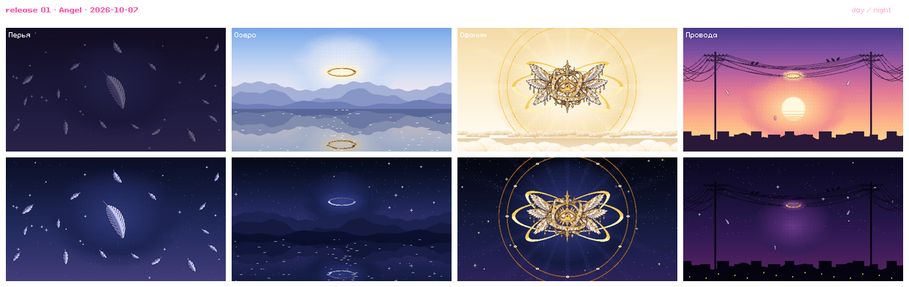
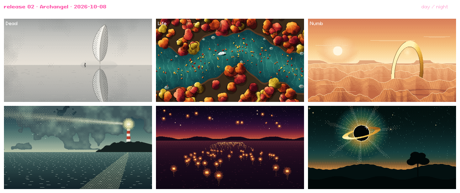
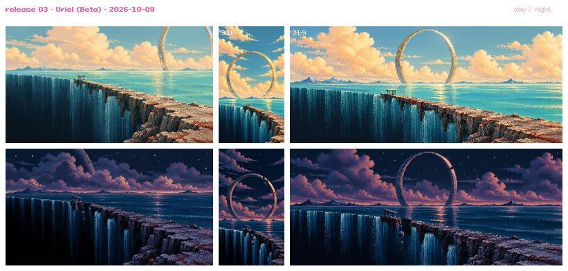

<sub>▶ <b>ВЕЩДОК 03-А</b> · содержимое <code>~/Pictures/AngelOS/</code>, релизы 01 Angel · 02 Archangel · 03 Uriel (Beta), день над ночью</sub>
</div>

`[00:03:02]` `Mod`+`Shift`+`Return`. *Выбор: одна картинка на все экраны, своя на монитор, своя на стол. Смена
играет пиксельную мозаику с дизером. Только когда меняется картинка; переключение столов остаётся мгновенным.*


<a id="tape-04"></a>

`[00:00:00]` **ГОЛОС:** «Так. Правой кнопкой по столу».

`[00:00:03]` *Меню. Он закрывает его, что-то меняет в настройках, снова жмёт правой. Другое меню. Ещё раз. И ещё.*

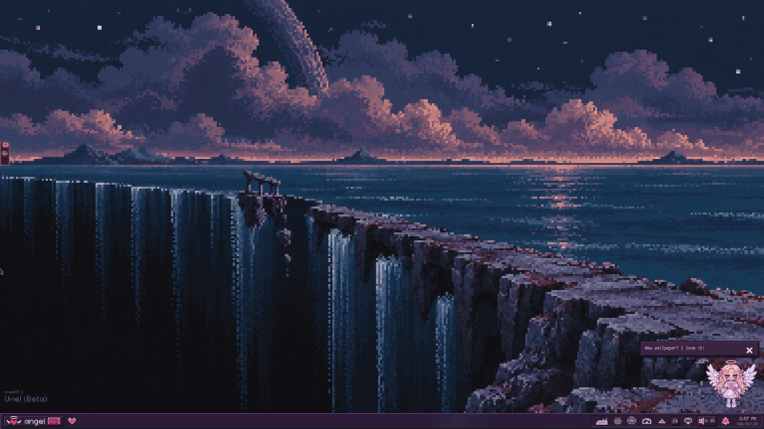

<sub>▶ <b>04 · 00:00:03 – 00:01:20</b> · список · кольцо · пузырь Y2K · плитки Пункта управления · крылья · арфа</sub>

`[00:01:21]` **ГОЛОС (считает на пальцах):** «Шесть». *Пауза.* «В настройках написано — шесть. А в файле семь».

`[00:01:25]` ░░░░ *седьмое есть на плёнке, одиннадцать кадров. Мы их не печатаем.* ░░░░

> **АРХИВИСТ.** Как бы оно ни выглядело, внутри одно и то же: быстрые действия сверху, **Вид ▸** (виджеты, режим
> правки, сетка), **Создать ▸** (заметка, скриншот, запись), **Открыть ▸** (папки), параметры экрана,
> персонализация, *Открыть в терминале* и **Показать больше ▸** для того, что добавили плагины. Что в нём, в каком
> порядке, свои пункты: *Настройки → Меню правой кнопки*.

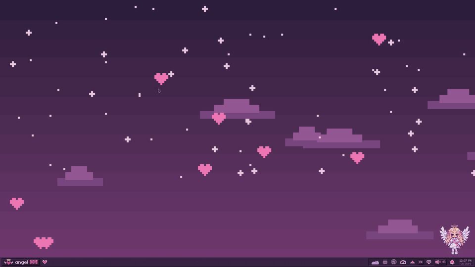

<sub>▶ <b>04 · 00:02:40</b> · он кладёт виджет на обои</sub>

`[00:02:40]` *Маленькие окошки на обоях: `clock.exe`, `sysmon.exe` (CPU, GPU, RAM, VRAM, сеть), `cava.exe`,
`music.exe`. Он тащит одно за заголовок. Двойной клик по заголовку — режим правки. Вокруг каждого пиксельное окно,
плашка или ничего.*


<a id="tape-05"></a>

`[00:00:00]` *Почти вся кассета — экран, снятый медленно, страница за страницей. Он говорит поверх, будто составляет
список, чтобы перестать удивляться.* Список мы сохранили.


<sub>▶ <b>05 · 00:00:00 – 00:14:51</b> · Настройки, все страницы</sub>

<details>
<summary><b>▶ РАСШИФРОВКА 05 · 00:00:20 – 00:14:51</b> <sub>(его список, дословно)</sub></summary>

<br>

- `[00:00:20]` «**Панель.** Шесть форм: таскбар, верхняя, остров, док, капсулы, *windose*. На любом краю экрана. Всё
  на ней перетаскивается».
- `[00:02:11]` «**Сами Настройки** — у них четыре лица. Windows 11, боковая панель macOS, Панель управления Win98,
  вкладки „Свойства“». *(`angelos settingsView …`)* «Есть поиск. Понимает синонимы. Помнит, что я искал».
- `[00:03:40]` «**Alt+Tab**, три стиля: angelOS, NGO, Y2K. Или родной niri с живыми превью».
- `[00:04:02]` «**Переключение столов**, тринадцать анимаций». *Зачитывает:* soft, dash, spring, snap, zoom,
  card, wipe, fade, dissolve, glitch, CRT, realm, instant. «И попап с надписью `workspace_N.exe`. И сердечки».
- `[00:05:30]` «**Экран входа**, пять обликов, живой предпросмотр, те же обои, что на столе. **Экран
  блокировки**, два: стрим с чатом или врата в небе».
- `[00:06:48]` «**fastfetch**, семь стилей». *compact, angel, helper, receipt, stream, window, mini.* «У каждого
  свой знак».
- `[00:07:30]` «**Шрифты** пресетами, пиксельные и нет. **Курсоры** пиксельные или `macOS`. **Звуки** паками, Y2K,
  Overdose, macOS; на каждый клик или никогда; под музыкой тише».
- `[00:09:12]` «**Окна:** пресеты ширины, ширина на приложение, где открываются новые». *Пауза.* «А на окне, которое
  часами не трогал, нарастает паутина. Я сам не поверил. Смотри». *Не показывает. Запись обрывается.*
- `[00:11:05]` «**Экран:** мониторы таскаешь по схеме. Точные частоты из списка niri, поворот, масштаб. Всё
  сохраняется, после перезагрузки на месте».
- `[00:13:40]` «Каждый раз, когда оно меняет конфиг niri, делает бэкап, прогоняет `niri validate` и откатывает,
  если niri против. Браузеры тоже идут за темой». *(Helium и Chromium через GTK, Firefox через
  `userChrome.css`.)*

</details>

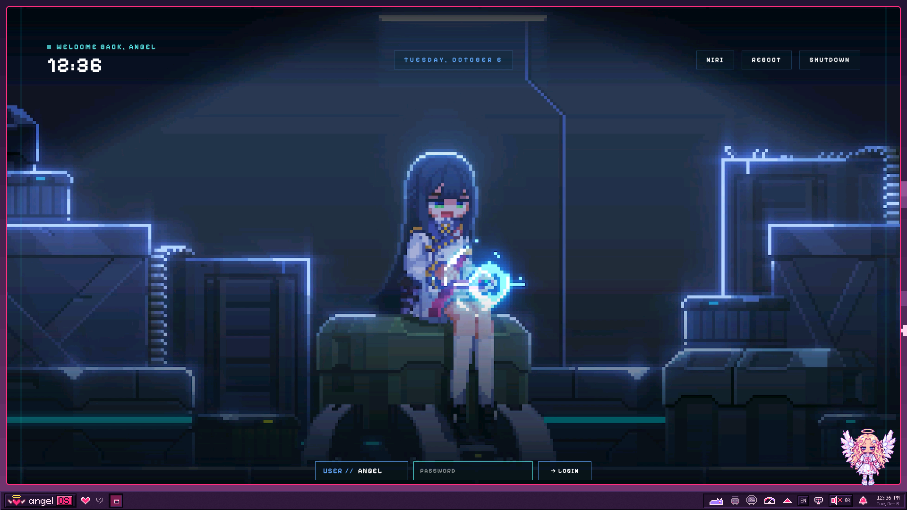

<sub>▶ <b>КАДР 05-А</b> · экран входа, каким он его оставил</sub>


<a id="tape-06"></a>


`[00:00:00]` **ГОЛОС:** «Окна не налезают друг на друга. Стоят колонками. На ленте. А лента уходит вправо без
конца».

`[00:00:09]` *Он открывает окно за окном; каждое новое открывается справа, и вид прокручивается за фокусом. Меняет
ширину колонки, ставит её по центру, складывает две, превращает их во вкладки, выкидывает одну плавающим окном.*
**ГОЛОС:** «Думал, возненавижу». *Долгая пауза.* «Нет».

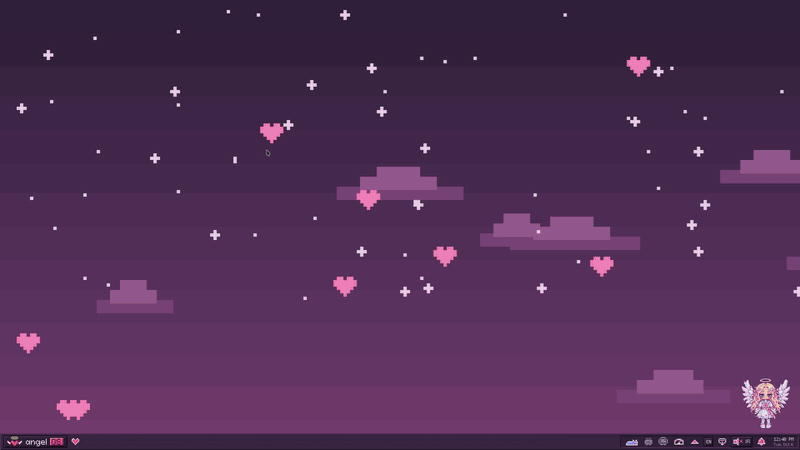

`[00:01:30]` `Mod`+`Tab`. *Камера отъезжает, а с ней и экран: все столы сразу.*


`[00:02:15]` `Mod`+`Space`. *Лаунчер. Нечёткий поиск, который запоминает, что он открывает. Набирает `web` — поиск,
`plugins` — каталог, `claude` — Claude Code, `>` — команда оболочки.*

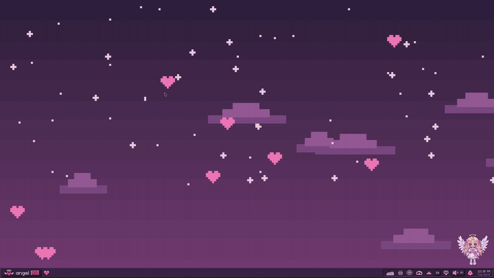

`[00:03:01]` **ГОЛОС:** «Забыл клавишу». `Mod`+`Shift`+`Esc`. *Подсказка niri; у каждого бинда человеческое название.*


`[00:03:40]` *Терминал. Пришёл уже одетым.*

> **АРХИВИСТ.** **fish** с промтом pure, fastfetch с логотипом angelOS вместо приветствия, eza, fzf, done,
> autopair (на CachyOS это `cachyos-fish-config`; на Arch то же самое ставится из `packages/fish.txt` и fisher).
> **kitty**, **foot** и **Alacritty** в палитре, **btop** и **fastfetch** тоже. **Neovim** с
> [LazyVim](https://lazyvim.github.io) встаёт только туда, где `~/.config/nvim` пуст; существующий конфиг не
> трогается никогда. `n` открывает его; `angelos …` лежит в `PATH`.

<details>
<summary><b>▶ ВЕЩДОК 06-А</b> · <code>ls ~/.local/bin</code>, как нашли</summary>

<br>

| утилита | что делает |
| --- | --- |
| `niri-screenshot-region` | область с пиксельными «верёвками гравитации» |
| `niri-record-region` | запись области в `~/Videos`, переключатель |
| `niri-ocr` | текст из области в буфер, все установленные языки Tesseract |
| `niri-cast-privacy` | чаты и менеджеры паролей чернеют на стриме |
| `niri-game-mode` | без анимаций, блюра и стекла, пока игра закрывает экран |
| `polkit-agent-guard` | диалог пароля приходит всегда |
| `voxtype-indicator` | диктовка |

Всё на простом Bash и Python.

</details>


<a id="tape-07"></a>

`[00:00:00]` *Рождество. В соседней комнате чужой голос, телевизор. Он переключился на второе лицо и показывает его
в камеру, как товар.* **ГОЛОС (в шутку, голосом диктора):** «macOS двадцать семь. *Golden Gate*».

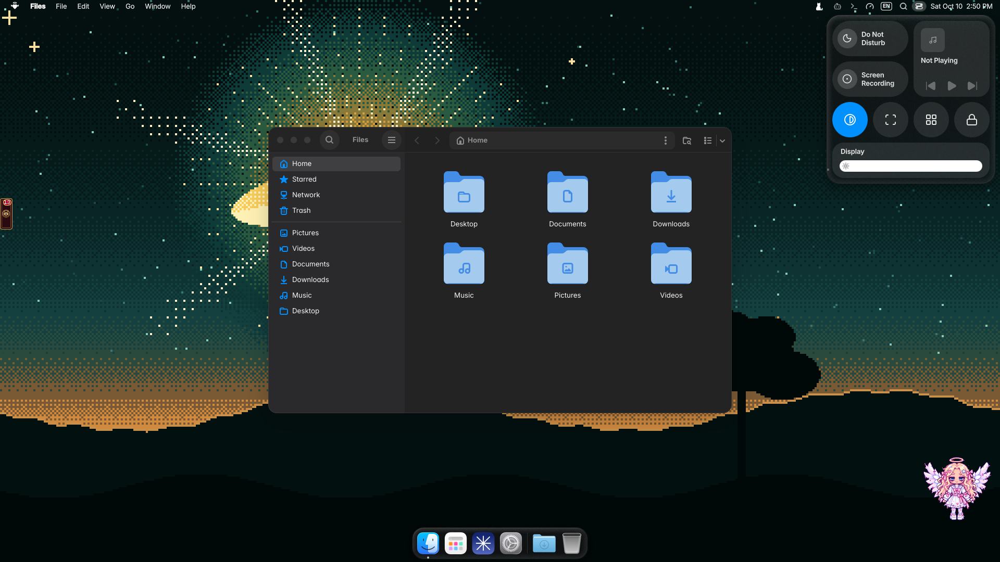

<sub>▶ <b>КАДР 07-А</b> · срисовано со скриншотов и гайдлайнов Apple, а не по памяти, и без единого файла Apple</sub>

`[00:00:40]` *Он показывает ручкой. Мы расшифровали, на что он показывает.*

- **`[00:00:40]` Строка меню.** 24 pt сверху каждого экрана. Слева эмблема angelOS (Об этом компьютере, Настройки,
  Завершить принудительно, Сон, Перезагрузка, Выключение, Блокировка, Выход), имя программы жирным и **её
  собственные меню**: Qt-программы через dbusmenu, GTK 3 через `appmenu-gtk-module`, действия GtkApplication, а для
  остальных стандартный набор из их же шорткатов. «В меню нет мёртвых пунктов. Я проверял». Справа: звук,
  раскладка, Wi-Fi и Bluetooth, когда они есть, трей, Spotlight, **Пункт управления**, дата. `Ctrl`+`F2` ходит по меню.
- **`[00:02:12]` Dock.** Плита Liquid Glass: закреплённые программы, *Программы*, недавние после разделителя,
  **свёрнутые окна**, «Загрузки», «Корзина». Точка под запущенными, меню по правой кнопке с окнами и действиями из
  `.desktop`, **увеличение** как на Mac (иконка под указателем растёт, соседи по косинусу, Dock расширяется в обе
  стороны, чтобы иконка осталась под указателем), автоскрытие. Иконки из
  [MacTahoe](https://github.com/vinceliuice/MacTahoe-icon-theme) (GPL-3.0, закреплённый релиз, проверка sha256).
- **`[00:03:30]` Сворачивание.** **ГОЛОС:** «niri не умеет сворачивать. Просто выбрасывает запрос». *Он жмёт жёлтый
  светофор. Окно сжимается в Dock снимком.* «А это умеет». *(Скрытый стол. Жёлтый светофор, Окно → Свернуть, `⌘M`
  или `angelos macMinimize`; назад — кликом по снимку, по иконке, в Alt+Tab или в обзоре.)*
- **`[00:04:15]` Spotlight** (`⌘Space`): тёмная стеклянная капсула для программ, файлов, действий, буфера. **Пункт
  управления** в раскладке macOS: Wi-Fi, Bluetooth, *Сейчас играет*, запись экрана, Mission Control, блокировка,
  тёмная тема, скриншот, «Не беспокоить», экран и звук. Дата открывает **Центр уведомлений**.
- **`[00:05:02]` Liquid Glass.** *Камера подходит вплотную к краю Dock.* Три слоя: блюр и насыщенность niri 26.04
  под стеклом, тон от прозрачного до цветного и край-линза (тёмный ободок, блик сильнее к свету, тонкая полоска
  «собранного» света с лёгким расщеплением цвета), нарисованный
  [`shaders/liquid_glass.frag`](.config/quickshell/angelos/shaders/liquid_glass.frag). *Уменьшить прозрачность*
  делает его сплошным.
- **`[00:05:50]` Звуки.** *Он трижды вставляет и вынимает флешку — ради звука.* Уведомление, ошибка, «поп»
  громкости, затвор, очистка Корзины, USB туда и обратно, зарядка, блокировка, вход; синтезированы
  `scripts/mac-sounds.py`, CC0. Файлы с теми же именами в `~/.local/share/angelos/sounds/macos/` их заменяют.

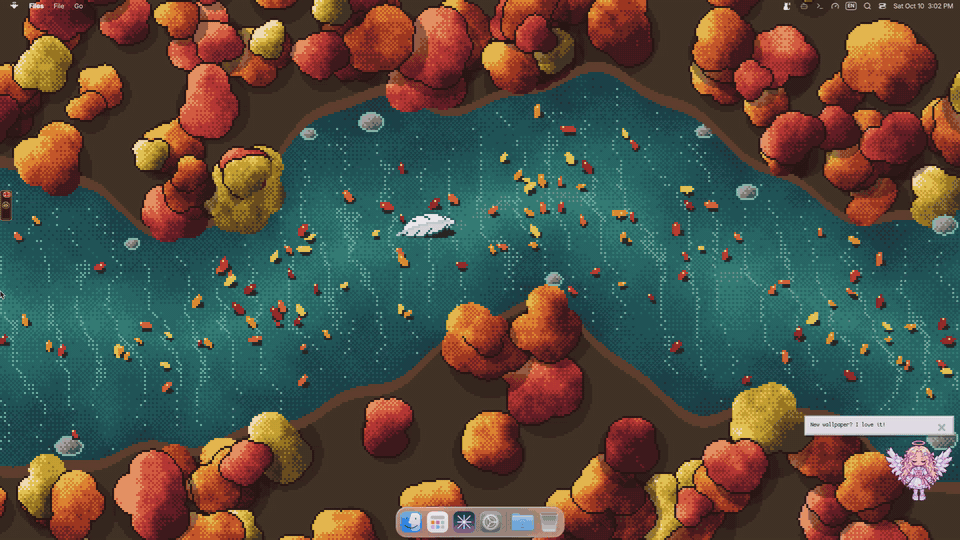


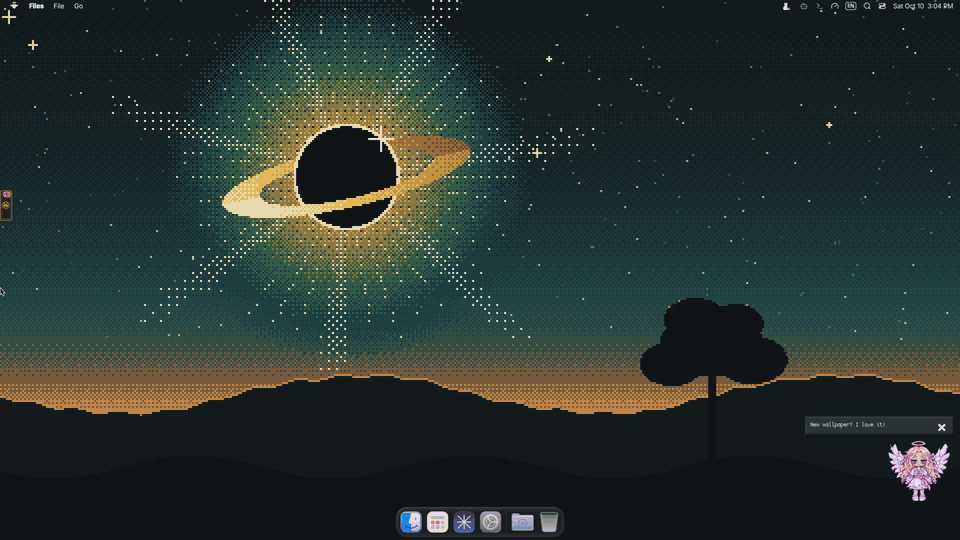

> **АРХИВИСТ.** Мы прошли весь диск в поисках чего-нибудь от Apple. Ничего нет. Эмблема angelOS вместо яблока,
> **Inter** (SIL OFL) вместо SF Pro, иконки Lucide, иконки Dock MacTahoe (GPL-3.0), курсор `macOS` из
> [ful1e5/apple_cursor](https://github.com/ful1e5/apple_cursor) (GPL-3.0), синтезированные звуки, нарисованные
> обои. MacTahoe, Inter и курсор скачиваются при первом включении облика, под своими лицензиями. Выбирается в
> установщике, в мастере (*«Пришёл с Mac?»*), в Настройки → Оформление или командой
> `angelos settingsSkin goldengate`.


<a id="tape-08"></a>

`[00:00:00]` *Ночь. Камера стоит на стопке книг и смотрит в правый нижний угол экрана. Его в кадре нет. Он шепчет.*

`[00:00:05]` **ГОЛОС:** «Она там с первого входа. Сидит на панели».

`[00:00:12]` *Маленькая пиксельная фигурка сидит на краю панели, свесив ноги.*

`[00:00:40]` **ГОЛОС:** «Она разговаривает. Нечасто. И не просто так. Заметила, когда я открыл шесть окон подряд.
Заметила, что я четыре часа сижу за экраном». *Пауза.* «Есть достижения. Сундуки. У неё есть дневник. С ключом, и
ключ мне пришлось заслужить, и она очень против» *[неразборчиво]* «…если читать его при ней».

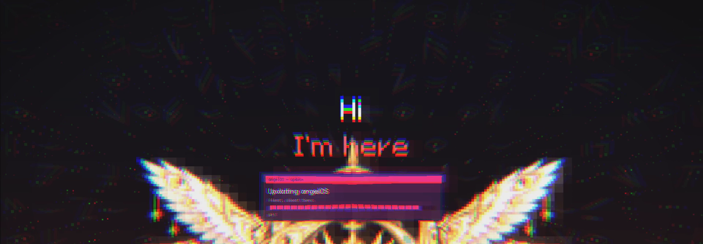

<sub>▶ <b>КАДР 01-Х</b> · единственный кадр, который удалось восстановить из повреждённой минуты на кассете 01</sub>

`[00:02:10]` *Где-то в системном блоке раскручивается диск. Звон. Её реплики звучат тоненьким голоском в духе
Undertale.*

`[00:02:30]` **ГОЛОС:** «Экран блокировки может быть стримом. С чатом, который тебе отвечает. Есть режим для
стримеров, там она сидит в кадре и читает чат».

`[00:03:33]` █████████████████████████████████████████████████████████████
`[00:03:41]` ██████ **ГОЛОС:** «…а под этим есть ещё этаж». ███████████████████████
`[00:04:02]` █████████████████████████████████████████████████████████████

> [!IMPORTANT]
> **АРХИВИСТ.** Прежде чем дать кому-то запускать диск, мы прочитали код. Вот что можем сказать точно:
> **может напугать, но вреда не причинит.** Не трогает ваши файлы, никуда ничего не шлёт, не читает ваши окна,
> браузер и переписки. Экран блокировки, меню питания, громкость, уведомления и polkit работают всегда, что бы ни
> происходило. У всего, что вспыхивает, трясётся и становится громким, есть переключатель *спокойно*.
>
> - **Выход сразу, в любой момент:** `angelos game off` или **`Mod`+`Ctrl`+`Shift`+`Esc`**. Остаются обычные
>   дотфайлы: её нет, меню правой кнопки теряет седьмой облик. `angelos game on` возвращает всё. Установщик и
>   мастер спрашивают заранее.
> - **Движение:** `angelos motion full|calm|off`. *Calm* — без вспышек, тряски и резких громких звуков. *Off* — без
>   анимаций вообще.
> - **Прогресс** живёт в `~/.config/angelos/save.json`. Обновления его не трогают.
>
> О нижнем этаже скажем только одно: Dock и строка меню тоже о нём знают.


<a id="tape-09"></a>

`[00:00:00]` **ГОЛОС:** «Для него пишут другие люди».

`[00:00:04]` *Настройки → Плагины. Каталог: одобренные записи
[реестра сообщества angelOS](https://github.com/futureUnd1ground/angelos-community-registry) рядом с тем, что уже
стоит. Установить, обновить, **откатить**. Он ставит один. На столе появляется виджет.*


<sub>▶ <b>09 · 00:00:04</b> · каталог. <code>plugins …</code> в лаунчере открывает то же самое</sub>

> **АРХИВИСТ.** Плагин — папка с `manifest.json`. Он может добавить пункты в меню правой кнопки, виджеты на панель и
> на стол, провайдеры лаунчера, страницу настроек и фоновый сервис; гайд —
> [`docs/PLUGINS.md`](.config/quickshell/angelos/docs/PLUGINS.md). Обновления проверяются раз в день; перед каждым
> установленная копия становится снимком, и плагин, который не загрузился, сам к нему возвращается.
> С включённым *режимом разработчика* **Plugin Studio** спрашивает, что должен делать плагин, задаёт встречные
> вопросы, пишет QML в теме с вашим ключом OpenAI или Anthropic, показывает файлы и проверяет их до установки
> ([гайд](.config/quickshell/angelos/docs/PLUGIN_STUDIO.md)).

| `[00:01:50]` уже на диске | что он о нём сказал |
| --- | --- |
| `cat` | «Кот на панели. Спит. Теперь гуляет. Теперь бежит — процессор загружен». |
| `speedtest` | тест скорости интернета с пиксельным спидометром и историей |
| `web-search` | `web …` в лаунчере: поисковики и любимые сайты |
| `claude-companion` | что осталось от плана Claude, живые сессии Claude Code, `claude …` в лаунчере |
| `codex-companion` | то же для OpenAI Codex: окна на 5 часов и неделю, токены за сегодня, живые сессии |
| `osu-mini` | «Там osu внутри». Под бит: пиксельные сердечки, комбо, ранги (`osu` в лаунчере) |
| `nightlight` | тёплый экран вечером через `wlsunset` |
| `stream-stats` | `stats.exe`: stress = CPU, darkness = RAM, love = аптайм |
| `quick-actions` | дополнительные пункты в меню правой кнопки |


<a id="tape-10"></a>

`[00:00:00]` *Утро. На столе кофе.* **ГОЛОС:** «Ночью обновилось. Ну как. Сначала спросило».

`[00:00:07]` *Настройки → Обновления. Что нового, последний запуск, кнопка.*

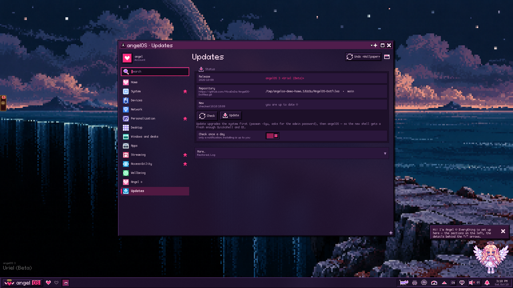

<sub>▶ <b>КАДР 10-А</b> · если что-то пойдёт не так, на кнопке внизу написано <i>Вернуть состояние до обновления</i></sub>

> **АРХИВИСТ.** Оно проверяет репозиторий, из которого было установлено, и по клику делает `git pull` и прогоняет
> установщик без пакетов. Прежде чем что-то изменится, каждый файл, который установщик может записать, копируется в
> `~/.local/state/angelos/backups/<дата>-update/`. Обновление засчитывается, только если прошли установщик, проводка
> niri и `niri validate`; иначе страница предлагает возврат. Запущенный angelOS спрашивает, перезапуститься сейчас
> или позже; окна остаются. Из терминала: `git pull && ./install.sh`.

`[00:01:20]` **ГОЛОС:** «Я кое-что менял. Оно не перезаписало». *Читает с экрана:*

- конфиг, который он не трогал, идёт за автором при каждом обновлении;
- тот, что он менял, получает правки автора слиянием, а где оба поменяли одни и те же строки, остаются его (старый
  файл рядом как `*.bak.<дата>`); шорткаты сливаются клавиша за клавишей;
- файлы, которые генерирует angelOS, остаются его, новые версии ждут в `~/.local/state/angelos/kept-updates/`;
- свои строки — в `~/.config/fish/user.fish` и `~/.config/niri/cfg/user.kdl`, читаются последними, никогда не
  трогаются;
- после обновления оно *предлагает* программы, которые автор добавил в группы, что он брал. Само никогда ничего не
  ставит и не удаляет.

`[00:02:45]` *Настройки → О системе → Сообщить о проблеме.* **ГОЛОС:** «Если сломается, вот это собирает один архив».

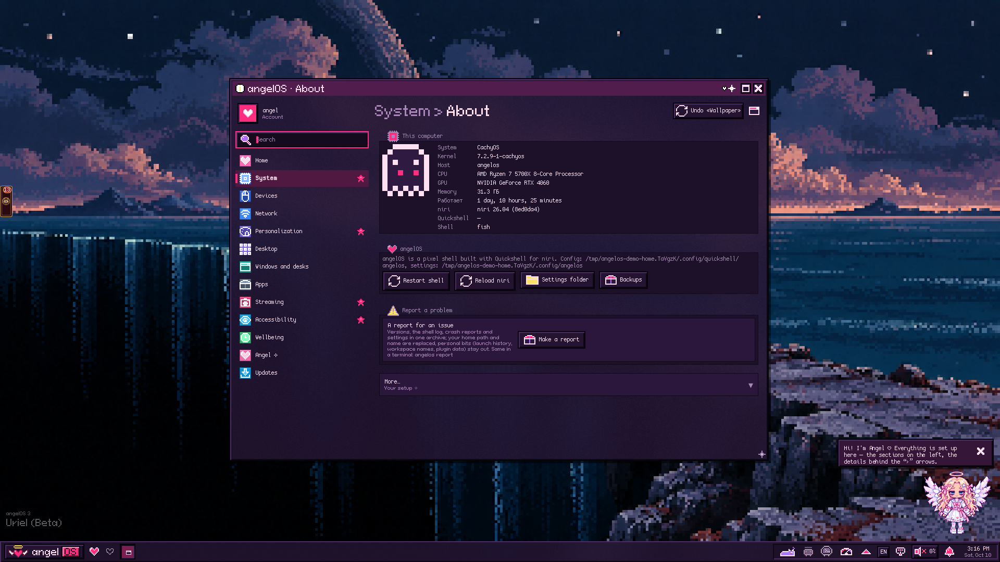

> **АРХИВИСТ.** `angelos report` делает то же из терминала: версии (angelOS, Quickshell, Qt, niri, ядро, GPU),
> состояние сервиса и перезапуски, сколько он стоит, лог, последние крэш-репорты, проверка конфига niri, плагины и
> настройки, с вырезанным личным (путь дома и имя пользователя становятся `~` и `<user>`; история лаунчера, имена
> столов и свободные тексты не попадают). **Никуда ничего не отправляется.** Архив ложится в `~/` со ссылкой на
> новый issue, а что прикладывать, решаете вы. Сторожок перезапускает оболочку, если она не отвечает пятнадцать
> секунд, и сохраняет крэш-репорт. Экран входа держит бэкап прежней темы. Установщик никогда не перезаписывает
> `monitor.kdl`.


<a id="tape-11"></a>


`[00:00:00]` *Кассеты за 29-е нет. Эта короткая, снята второпях. Он снимает заднюю стенку системного блока, кабели,
ноутбук на кровати, второй монитор, повёрнутый боком, геймпад.* **ГОЛОС:** «Пойдёт ли у тебя? Скорее всего.
Слушай».

| `[00:00:20]` | |
| --- | --- |
| **Система** | CachyOS или Arch Linux. Установщик добавляет только репозиторий `[cachyos]`, где его нет; пакеты Arch в приоритете. Драйверный вопрос Steam больше не тянет ничего экзотического. |
| **GPU** | NVIDIA и AMD. Системный монитор читает обе; Qt-фиксы для NVIDIA уже внутри. |
| **Ноутбук** | батарея и предел заряда, эко-режим, клавиши яркости и подсветки клавиатуры, направление прокрутки и ускорение тачпада; в мастере и в Настройках, и показывается только на ноутбуке. |
| **Мониторы** | сколько угодно, любая частота (точно та, что в списке niri, так что 144 Гц остаются 144 Гц после перезагрузки), масштаб, поворот, вертикальные экраны с обоями 9:16, ультраширокие с 21:9. Называются по *производитель модель серийник*, так что переименованный разъём всё равно совпадёт. |
| **Клавиатуры** | любые раскладки и своё сочетание переключения; они же выбирают язык диктовки и пакеты OCR. ⌘-клавиши для тех, кто с Mac, кнопки окон GTK для тех, кто с Windows. |
| **Языки** | английский и русский: установщик, мастер, оболочка и она. |
| **Браузеры** | Helium, Firefox, Chromium, Brave, Zen, LibreWolf, Vivaldi или Chrome; мастер спрашивает, `Mod`+`B` открывает выбранный. |
| **Доступность** | размер интерфейса, движение, контраст, лупа (`Mod`+`Alt`+`=`), голосовая диктовка, «потряси мышь, чтобы найти курсор». Экранное время, перерывы, вода: напоминает она. |
| **Геймпады** | оболочка знает твой контроллер, его кнопки и оси. |
| **Стрим** | режим стрима, который видит OBS, `niri-cast-privacy` для чатов и менеджеров паролей, игровой режим, снимающий эффекты, пока игра закрывает экран. |

`[00:02:58]` **ГОЛОС:** «Завтра последняя. Сниму всё. Каждый файл».


<a id="tape-12"></a>

`[00:00:00]` *Новогодняя ночь. Где-то далеко за окном салют. Камера медленно ведёт по файловому менеджеру, папка за
папкой. Голос у него счастливый.*

`[00:00:10]` **ГОЛОС:** «Тут всё. Вообще всё. MIT. Дотфайлы, оболочка, обои».

```text
.config/quickshell/angelos/  angelOS: оболочка, оба облика, плагины, шаблоны, документация
.config/niri/                niri: конфиг, профили клавиш (common / pixel / macos), правила, анимации
.config/                     fish, kitty, foot, Alacritty, GTK, btop, fastfetch, Neovim, Voxtype
.local/bin/                  утилиты
.local/share/                тема иконок pixora и пиксельные шрифты
Pictures/AngelOS/            обои каждого релиза с подсказками сцен
packages/                    pacman.txt, angelos.txt, sddm.txt, tools.txt, fish.txt, nvim.txt (программы: data/apps-catalog.json)
installer/tui.sh             лицо установщика: меню gum, пиксельные рамки, сердечки, чат стрима
install.sh                   установщик: спрашивает всё, бэкапит, только Arch Linux / CachyOS
scripts/check.sh             проверка репозитория со сквозными тестами установщика
scripts/demo/                стенд, в котором сняты кадры и записи этой страницы
docs/                        кадры и записи этой страницы
```

`[00:00:58]` **ГОЛОС:** «Паролей тут нет. Ни ключей, ни токенов, ничего из браузера, ни cookies, ни истории. Есть
проверка, она падает, если что-то такое проскочит». *(`scripts/check.sh`, та же, что гоняет GitHub;
`scripts/ci-local.sh` запускает её в контейнере `archlinux`.)* «Мои настройки остаются моими». *(`~/.config/angelos`.)*

`[00:01:20]` **ГОЛОС:** «Если что не так — пишите issue. С репортом. Pull request тоже».

`[00:01:31]` *Запах упоминается впервые.* **ГОЛОС (в стороне от микрофона):** «…это что, компьютер?» *[смеётся]*
«Да нормально всё. Он всегда тёплый».

`[00:01:40]` ░░░░░░░░░░░░░░░░ *Он что-то сохраняет.* ░░░░░░░░░░░░░░░░

`[00:01:41]` **НЕТ СИГНАЛА**

> **АРХИВИСТ.** Лицензия: MIT, целиком, см. [`LICENSE`](LICENSE), © 2026 MixaDoDs. Чужие части остаются под своими
> лицензиями, список в [`THIRD-PARTY.md`](THIRD-PARTY.md).


<a id="tape-keys"></a>

> **АРХИВИСТ.** Нашлось, когда мы перевернули клавиатуру: сложенный лист, приклеенный скотчем, тем же почерком, что
> и клочок бумаги. У каждого облика свой профиль клавиш: [`keybinds.kdl`](.config/niri/cfg/keybinds.kdl) только
> выбирает один, [`keybinds-common.kdl`](.config/niri/cfg/keybinds-common.kdl) (оба облика) плюс
> [`keybinds-pixel.kdl`](.config/niri/cfg/keybinds-pixel.kdl) или [`keybinds-macos.kdl`](.config/niri/cfg/keybinds-macos.kdl).
> Настройки → Клавиатура правят тот, что сейчас впереди.

<details>
<summary><b>▤ ЛИСТ 1</b> · оба облика</summary>

| Клавиши | Действие |
| --- | --- |
| <kbd>Mod</kbd>+<kbd>T</kbd> | Терминал (kitty) |
| <kbd>Mod</kbd>+<kbd>B</kbd> | Браузер по умолчанию |
| <kbd>Mod</kbd>+<kbd>E</kbd> | Файлы (Nautilus) |
| <kbd>Mod</kbd>+<kbd>V</kbd> | История буфера обмена |
| <kbd>Mod</kbd>+<kbd>S</kbd> / <kbd>Mod</kbd>+<kbd>Alt</kbd>+<kbd>S</kbd> | Настройки |
| <kbd>Mod</kbd>+<kbd>Shift</kbd>+<kbd>Return</kbd> | Выбор обоев |
| <kbd>Mod</kbd>+<kbd>Shift</kbd>+<kbd>Q</kbd> | Меню питания |
| <kbd>Mod</kbd>+<kbd>Alt</kbd>+<kbd>T</kbd> / <kbd>Mod</kbd>+<kbd>Alt</kbd>+<kbd>Y</kbd> | Светлая ⇄ тёмная / лирика вкл-выкл |
| <kbd>Mod</kbd>+<kbd>Shift</kbd>+<kbd>S</kbd> | Скриншот области («верёвки гравитации») |
| <kbd>Mod</kbd>+<kbd>Shift</kbd>+<kbd>R</kbd> | Запись области (переключатель) |
| <kbd>Mod</kbd>+<kbd>Shift</kbd>+<kbd>V</kbd> | Голосовая диктовка (переключатель) |
| <kbd>Mod</kbd>+<kbd>Shift</kbd>+<kbd>X</kbd> | Приватность трансляции: чаты и менеджеры паролей чернеют на стриме |
| <kbd>Ctrl</kbd>+<kbd>Shift</kbd>+<kbd>2</kbd> / <kbd>3</kbd> | Скриншот экрана / окна |
| <kbd>Mod</kbd>+<kbd>Shift</kbd>+<kbd>←→↑↓</kbd> | Фокус на другой монитор (+<kbd>Ctrl</kbd>: перенести туда колонку) |
| <kbd>Mod</kbd>+<kbd>Shift</kbd>+<kbd>P</kbd> | Выключить мониторы |
| <kbd>Alt</kbd>+<kbd>Tab</kbd> | Переключатель окон angelOS |
| <kbd>Mod</kbd>+<kbd>Alt</kbd>+<kbd>=</kbd> / <kbd>-</kbd> / <kbd>0</kbd> | Лупа: ближе / дальше / закрыть |
| <kbd>Mod</kbd>+<kbd>Esc</kbd> | Отпустить захват клавиатуры полноэкранной программой |
| <kbd>Mod</kbd>+<kbd>Ctrl</kbd>+<kbd>Shift</kbd>+<kbd>Esc</kbd> | **Выйти из игры сразу** |
| <kbd>Ctrl</kbd>+<kbd>Alt</kbd>+<kbd>Delete</kbd> | Выйти из niri |

Медиа-клавиши и громкость идут в `angelos …` (маленький OSD показывает уровень) и работают на экране блокировки.

</details>

<details>
<summary><b>▤ ЛИСТ 2</b> · Pixel</summary>

| Клавиши | Действие |
| --- | --- |
| <kbd>Mod</kbd>+<kbd>Space</kbd> | Лаунчер |
| <kbd>Mod</kbd>+<kbd>Q</kbd> | Закрыть окно |
| <kbd>Mod</kbd>+<kbd>Alt</kbd>+<kbd>L</kbd> | Заблокировать экран |
| <kbd>Mod</kbd>+<kbd>H</kbd> / <kbd>Mod</kbd>+<kbd>L</kbd> (или стрелки) | Фокус на колонку слева / справа (+<kbd>Ctrl</kbd>: перенести её) |
| <kbd>Mod</kbd>+<kbd>J</kbd> / <kbd>Mod</kbd>+<kbd>K</kbd> | Фокус на окно ниже / выше |
| <kbd>Mod</kbd>+<kbd>1</kbd>…<kbd>9</kbd> / <kbd>Mod</kbd>+<kbd>Ctrl</kbd>+<kbd>1</kbd>…<kbd>9</kbd> | На стол / перенести туда колонку |
| <kbd>Mod</kbd>+<kbd>O</kbd> | Предыдущий стол |
| <kbd>Mod</kbd>+<kbd>Tab</kbd> | Обзор |
| <kbd>Mod</kbd>+<kbd>R</kbd> / <kbd>Mod</kbd>+<kbd>Alt</kbd>+<kbd>R</kbd> | Следующая / предыдущая ширина колонки |
| <kbd>Mod</kbd>+<kbd>C</kbd> | Колонку в центр |
| <kbd>Mod</kbd>+<kbd>[</kbd> / <kbd>Mod</kbd>+<kbd>]</kbd> | Втянуть окно в соседнюю колонку или вытолкнуть |
| <kbd>Mod</kbd>+<kbd>W</kbd> | Колонка вкладками |
| <kbd>Mod</kbd>+<kbd>Shift</kbd>+<kbd>Space</kbd> | Плавающее ⇄ в сетке |
| <kbd>Mod</kbd>+<kbd>F</kbd> / <kbd>Mod</kbd>+<kbd>Shift</kbd>+<kbd>F</kbd> / <kbd>Mod</kbd>+<kbd>M</kbd> | Полный экран / развернуть колонку / развернуть до краёв |
| <kbd>Mod</kbd>+<kbd>-</kbd> / <kbd>Mod</kbd>+<kbd>=</kbd> | Колонка уже / шире |
| <kbd>Mod</kbd>+<kbd>Shift</kbd>+<kbd>T</kbd> | OCR области в буфер |

</details>

<details>
<summary><b>▤ ЛИСТ 3</b> · macOS (⌘ = Super)</summary>

⌘-клавиши по желанию: установщик спрашивает (`MAC_KEYS=1|0`), а *Настройки → Оформление → Golden Gate*
включают и выключают их. Без них облик macOS оставляет пиксельные клавиши.

| Клавиши | Действие |
| --- | --- |
| <kbd>⌘</kbd><kbd>Space</kbd> | Spotlight |
| <kbd>⌘</kbd><kbd>Q</kbd> | Выйти из программы впереди (её собственный *Выход*, иначе все её окна) |
| <kbd>⌘</kbd><kbd>W</kbd> | Закрыть окно |
| <kbd>⌘</kbd><kbd>M</kbd> | Свернуть в Dock |
| <kbd>⌘</kbd><kbd>H</kbd> | Скрыть программу |
| <kbd>⌘</kbd><kbd>Tab</kbd> / <kbd>⌘</kbd><kbd>⇧</kbd><kbd>Tab</kbd> | Переключить программу |
| <kbd>⌘</kbd><kbd>`</kbd> | Следующее окно той же программы |
| <kbd>⌘</kbd><kbd>,</kbd> | Системные настройки |
| <kbd>⌘</kbd><kbd>⇧</kbd><kbd>3</kbd> / <kbd>4</kbd> / <kbd>5</kbd> | Скриншот: экран / область / меню скриншота |
| <kbd>⌃</kbd><kbd>⌘</kbd><kbd>F</kbd> | Полный экран |
| <kbd>⌃</kbd><kbd>⌘</kbd><kbd>Q</kbd> | Заблокировать экран |
| <kbd>⌥</kbd><kbd>⌘</kbd><kbd>Esc</kbd> | Завершить принудительно |
| <kbd>⌃</kbd><kbd>←</kbd> / <kbd>⌃</kbd><kbd>→</kbd> | Стол слева / справа |
| <kbd>⌃</kbd><kbd>↑</kbd>, <kbd>F3</kbd> | Mission Control (обзор) |
| <kbd>⌃</kbd><kbd>F2</kbd> | Строка меню с клавиатуры |
| <kbd>⌘</kbd><kbd>⌥</kbd><kbd>Space</kbd> | Лаунчер angelOS |
| <kbd>⌘</kbd><kbd>⌥</kbd> + <kbd>H</kbd> <kbd>J</kbd> <kbd>K</kbd> <kbd>L</kbd> / стрелки, <kbd>1</kbd>…<kbd>9</kbd>, <kbd>R</kbd>, <kbd>C</kbd>, <kbd>F</kbd>, <kbd>W</kbd> | Тайлинг: пиксельные клавиши на один <kbd>Alt</kbd> дальше |

Внутри программ их собственные сочетания остаются своими (<kbd>Ctrl</kbd>+<kbd>C</kbd>, <kbd>Ctrl</kbd>+<kbd>V</kbd>), и в меню они подписаны так же.

</details>

<details>
<summary><b>▤ ЛИСТ 4</b> · экран входа (SDDM), если капризничает</summary>

| Симптом | Что делать |
| --- | --- |
| Загружается в текстовую консоль | `sudo systemctl enable --force sddm && sudo systemctl set-default graphical.target` |
| `display-manager.service already exists` | отключить другой (`gdm`, `lightdm`, `ly@tty2`, `greetd`), потом включить SDDM |
| Обычный SDDM вместо темы angelOS | `grep -r Current= /etc/sddm.conf /etc/sddm.conf.d/`; поставить `qt6-declarative` |
| Нет обоев | выбрать обои в angelOS и проверить `/usr/share/sddm/themes/angelos/walls/` |

Посмотреть тему, не выходя из сессии: `sddm-greeter-qt6 --test-mode --theme /usr/share/sddm/themes/angelos`.

</details>


<div align="center">
<sub><code>♡ thank you for watching the stream ♡</code></sub>
</div>
